# 物理重点

> 来源：扫描件《物理重点》，共 45 页。页面为马文蔚《物理学》（第七版）下册的重点页，并有读者手写批注。
>
> 本文件按扫描顺序逐页转录，不是摘要。印刷正文写成可复制文字，公式为 LaTeX；手写增补、旁注、圈画和下划线分别用【手写】【手写圈出】【手写下划线】标出。原书插图从扫描件裁出，用相对路径引用。看不清处写【无法辨认】并保留裁图，不补扫描页上没有的书页。
>
> 印刷公式在与扫描件公式编号、前后文一致时，采用同版教材已核对过的 LaTeX；页界半句保留截断，不把下一页补进来。

## 页码对照

| 扫描页 | 书中位置（由页眉识别） | 本页公式编号 | 裁图 |
| --- | --- | --- | --- |
| 1 | 书中印刷页码见页眉（本页 OCR 未单独认出阿拉伯页码）；页眉含章名；页眉摘录：第九章振动 常见的振动是一种周期性的运动.所谓周期性运动是指在时间上具有重 复性或往复性的一种运 | — | — |
| 2 | 书中印刷页码见页眉（本页 OCR 未单独认出阿拉伯页码）；页眉含章名；页眉摘录：第九章振动 左加速运动，当抵达平衡位置时，物体所受 的弹性力减小到零.但物体的惯性会使它继 续向 | 9-1、9-3 | p02-图9-1弹簧振子的振动.jpg、p02-fig-2.jpg |
| 3 | 书中印刷页码见页眉（本页 OCR 未单独认出阿拉伯页码）；可见节号 9-1；页眉摘录：f 9-1 简谐振动振幅周期和频率相位 3 W 应方程 V x=Acos(wt+p) (9-5) | 9-5、9-3、9-6、9-7 | p03-图9-2所示的x-tu-t和a-t图由图可以看.jpg、p03-图9-2.jpg、p03-fig-1.jpg |
| 4 | 书中印刷页码约 13；可见节号 9-4；页眉摘录：9-4简谐振动的能量 13 9-4 简谐振动的能量 船量守恒 我们仍以图9-1所示的弹簧振子为例 | 9-20、9-21、9-22 | p04-与势能E不断地相互转化总能量却保持恒定如图9-1.jpg、p04-图9-13弹簧振子的能量和时间的关系曲线0.jpg、p04-fig-1.jpg |
| 5 | 书中印刷页码约 16；页眉含章名；页眉摘录：16 第九章振动 （2）从第n滴油滴滴人容器到第n+1滴油滴滴人容器，所经历的时间为质量为（m， | — | p05-这就表明合振动仍是简谐振动它的角频图9-17用旋.jpg |
| 6 | 书中印刷页码约 17；可见节号 9-5；页眉摘录：9-5简谐振动的合成 17 率与分振动的角频率相同，而其合振幅由平行四边形对角线求得： A= √ | 9-23、9-24、9-25、9-26、9-27 | — |
| 7 | 书中印刷页码约 18；页眉含章名；可见节号 9-1；页眉摘录：18 第九章振动 此时合振动的轨迹是一条通过坐标原点的直线,其斜率等于两个分振动振幅之 比[图9 | 9-27 | p07-图9-18.jpg、p07-fig-1.jpg、p07-fig-2.jpg、p07-fig-3.jpg、p07-fig-4.jpg、p07-fig-5.jpg |
| 8 | 书中印刷页码约 22；页眉含章名；可见节号 9-2；页眉摘录：22 第九章振动 动的振幅分别为A,和A（=A,）,初相分别为,和2,角频率分别为∞,和, 设@ | 9-29 | p08-图9-23拍.jpg、p08-fig-1.jpg、p08-fig-2.jpg |
| 9 | 书中印刷页码约 23；可见节号 9-6；页眉摘录：9-6阻尼振动受迫振动共振 23 期性变化,从而出现振幅时大时小的现象，合振幅在0~2A,范围内 | 9-30 | p09-图9-24两个同方向不同.jpg、p09-fig-1.jpg、p09-fig-2.jpg |
| 10 | 书中印刷页码约 45；可见节号 10-1；页眉摘录：10-1机械波的几个概念 45 二、横波与纵波 按照质元振动方向和波的传播方向的关系，机械波可分 | — | p10-图10-1机械波的形成.jpg、p10-就依次左右振动起来如图10-1b所示这种各质元的.jpg |
| 11 | 书中印刷页码约 46；页眉含章名；页眉摘录：46 第十章波动 进一步说、在弹性介质中形成横波时，必是一层介质相对于另一层介质 横向的平移，即 | — | — |
| 12 | 书中印刷页码约 50；页眉含章名；页眉摘录：50 第十章波动 质元作简谐振动，为简便计，设其初相为零，故其运动方程为 y=Acos(or+) | 10-3a、10-3b、10-3、10-4a | p12-fig-1.jpg、p12-fig-2.jpg |
| 13 | 书中印刷页码约 51；可见节号 10-2；页眉摘录：10-2平面简谐波的波函数 51 y=Acos 2π (10-4b) y=Acos(wt+kx) | 10-4b、10-4c、10-5、10-3、10-4 | p13-fig-1.jpg、p13-fig-2.jpg |
| 14 | 书中印刷页码约 56；页眉含章名；页眉摘录：56 第十章波动 若它的左端发生了位移y,右端位移为y+dy,这表明它不仅发生了运动，而 能为 | 10-3a、10-8、10-7、10-9 | p14-fig-1.jpg、p14-fig-2.jpg |
| 15 | 书中印刷页码约 67；可见节号 10-5；页眉摘录：10-5驻波 67 y,=Acos 2 y2=Acos 2π vt+ x 式中A 为波的振幅,v | 10-17、10-18 | p15-fig-1.jpg |
| 16 | 书中印刷页码约 72；页眉含章名；可见节号 10-3；页眉摘录：72 第十章波动 反=10-3cos 200π （2）y=yx+y反=2x10²cos/πx+ | — | p16-fig-1.jpg |
| 17 | 书中印刷页码约 73；可见节号 10-6；页眉摘录：10-6多普勒效应 73 波源和观察者沿着它们的连线相对介质运动的情形. 一、波源不动，观察者相 | 10-22、10-23 | p17-图10-29观察者运动时的.jpg |
| 18 | 书中印刷页码见页眉（本页 OCR 未单独认出阿拉伯页码）；页眉含章名；可见节号 10-3；页眉摘录：第十章波动 波源已运动到了S（S,S=v.T），此时才发出与该振动状态相位差为2π的 个振动状态 | 10-25 | p18-图10-30波源运动时的多普勒效应.jpg |
| 19 | 书中印刷页码约 73；可见节号 10-6；页眉摘录：10-6多普勒效应 73 utvo u干v， (10-26) 上式中，观察者向着波源运动时,前取 | 10-26 | p19-图10-32中AB为两个汽笛其频率均为500Hz.jpg |
| 20 | 书中印刷页码约 97；可见节号 11-1；页眉摘录：11-1 相干光 97 200年，才分别由傅科（J.B.L.Foucault，1819-1868 | — | — |
| 21 | 书中印刷页码约 100；页眉含章名；页眉摘录：100 第十一章光学 是激光束干涉实验的示意图，图中通过 A、B两个狭缝的激光是相干光, 互干涉 | — | p21-如图11-5所示由光源L发出的光照射在单缝S上.jpg、p21-图11-5杨氏双缝干涉实验.jpg、p21-fig-1.jpg |
| 22 | 书中印刷页码约 101；可见节号 11-2；页眉摘录：11-2杨氏双缝干涉劳埃德镜 101 下面定量分析屏幕上形成干涉明、暗条纹所应满足的条件.如图1 | 11-1、11-2 | p22-图11-6杨氏双缝干涉条纹的计算.jpg |
| 23 | 书中印刷页码约 102；页眉含章名；页眉摘录：102 第十一章光学 即 d' Y x=± (2k+1) k=0,1,2,... 时,两束光干涉 | 11-2、11-3 | p23-图11-7两种不同颜色光的干涉条纹位置错开.jpg |
| 24 | 书中印刷页码约 103；可见节号 11-2；页眉摘录：11-2杨氏双缝干涉劳埃德镜 103 k=0,1,2,... =1和k=4代人上式得，第一级与第 | 11-2、11-3、9-23、11-4a、11-4b、11-4c | p24-设图11-6中狭缝SS2发出的光波单独到达屏上任.jpg、p24-图11-8杨氏双缝干涉光强分布.jpg |
| 25 | 书中印刷页码约 104；页眉含章名；可见节号 11-8；页眉摘录：104 第十一章光学 光源S,S。相干,所以△对各点是确定的，两光的叠加是相干叠加，光强I呈现如 | 11-4b、11-5 | p25-图11-9光在真空中的波长和在介质中的波长.jpg、p25-fig-1.jpg |
| 26 | 书中印刷页码见页眉（本页 OCR 未单独认出阿拉伯页码）；页眉含章名；页眉摘录：第十二章 气体动理论 物质的运动形式是多种多样的.在力学中已经研究了物质最简单的运动 形式一—— | — | — |
| 27 | 书中印刷页码约 186；页眉含章名；页眉摘录：186 第十二章气体动理论 子都具有各自的质量、速度,动量、能量等,这些描述个别分子的物理量称为 | — | p27-fig-1.jpg |
| 28 | 书中印刷页码约 187；可见节号 12-1；页眉摘录：12-1平衡态理想气休物态方程热力学第零定律 187 免地会与外界发生不同程度的能量和物质的传递 | — | p28-fig-1.jpg |
| 29 | 书中印刷页码约 188；页眉含章名；可见节号 10-2；页眉摘录：188 第十二章气体动理论 式中N是体积V中的气体分子数，k称为玻耳兹曼常量，一般计算时，取 k | 12-1a、12-1b、12-1c、12-1d | p29-如图12-2a所示AB两个物体放在绝热板上物体间.jpg、p29-fig-1.jpg、p29-fig-2.jpg |
| 30 | 书中印刷页码约 195；可见节号 12-4；页眉摘录：12-4理想气体分子的平均平动动能与温度的关系 195 把它代人式（12-2），并设n=- 一为 | 12-2、12-3a、12-3b、12-3c、12-3、12-4、12-1d | — |
| 31 | 书中印刷页码约 196；页眉含章名；可见节号 12-5；页眉摘录：196 第十二章气体动理论 (12-5) 这就是理想气体分子的平均平动动能与温度的关系式.如同压 | 12-5 | — |
| 32 | 书中印刷页码约 202；页眉含章名；可见节号 12-1；页眉摘录：202 第十二章气体动理论 而物质的量为v的理想气体的内能则为 E=v—-RT (12-11h) | 12-11h、12-12、12-6 | p32-fig-1.jpg、p32-fig-2.jpg、p32-fig-3.jpg、p32-fig-4.jpg |
| 33 | 书中印刷页码见页眉（本页 OCR 未单独认出阿拉伯页码）；页眉含章名；页眉摘录：第十三章热力学基础 上一章从气体分子热运动观点出发，运用统计方法研究了气体分子热运 动的规律及理 | — | — |
| 34 | 书中印刷页码约 230；页眉含章名；页眉摘录：230 第十三章热力学基础 生变化的.然而，也会有这样的情形：当系统与外界之间发生能量传递时，系 | 13-2、13-3 | — |
| 35 | 书中印刷页码约 231；可见节号 13-3；页眉摘录：13-3理想气体的等容过程和等压过程 星摩尔热容 231 为E,的状态 A 可经 ACB 的过程 | — | — |
| 36 | 书中印刷页码约 232；页眉含章名；可见节号 13-4；页眉摘录：232 第十三章热力学基础 在等容过程中,气体的体积V是常量，气体不对外做功，即dW=pdV=0 | 13-4a、13-4b、13-5、13-6a、13-6b、13-7a、13-7b | p36-图13-5等容过程.jpg |
| 37 | 书中印刷页码约 234；页眉含章名；可见节号 13-8；页眉摘录：234 第十三章热力学基础 APd+ap="0p (13-8) 式(13-8)表明,在等压过程中 | 13-8、13-9a、13-9b、13-9c、13-10 | p37-图13-6等压过程.jpg、p37-fig-1.jpg |
| 38 | 书中印刷页码约 235；可见节号 13-3；页眉摘录：13-3理想气体的等容过程和等压过程摩尔热容 235 前实验值并不相同，但C,与C，之差即C,- | 13-11、13-7b、13-12 | p38-fig-1.jpg |
| 39 | 书中印刷页码约 240；页眉含章名；可见节号 13-1；页眉摘录：240 第十三章热力学基础 Q= W,=vRTln =vRTln P1 (13-14) P2 上 | 13-14 | p39-图13-10理想气体的绝热过程.jpg、p39-fig-1.jpg、p39-fig-2.jpg |
| 40 | 书中印刷页码约 241；可见节号 13-4；页眉摘录：13-4理想气体的等温过程和绝热过程多方过程 241 因为在绝热过程中dQ=0,所以由热力学第一 | 13-15、13-16、13-17a、13-17b、13-17c、13-18a、13-18b | — |
| 41 | 书中印刷页码约 246；页眉含章名；可见节号 13-1；页眉摘录：246 第十三章热力学基础 是多种多样的，所以不能都视为等值过程和绝热过程， 与理想气体的绝热过 | 13-19a、13-19b、13-19c、13-18b | p41-图13-14用多方指数.jpg |
| 42 | 书中印刷页码约 248；页眉含章名；可见节号 13-1；页眉摘录：248 第十三章热力学基础 冷机（也叫热泵）①，它是利用外界做功使热量由低温处流人高温处，从而获 | 13-20 | p42-图13-17.jpg、p42-fig-1.jpg |
| 43 | 书中印刷页码约 249；可见节号 13-5；页眉摘录：13-5循环过程卡诺循环 249 有内燃机、喷气机等①.虽然它们在工作方式、效率上各不相同，但工 | 13-21 | p43-图13-18制冷机的示意图.jpg |
| 44 | 书中印刷页码约 250；页眉含章名；页眉摘录：250 第十三章热力学基础 则有 T, Tc T, Tc-Tn T,T,' T、T,-T 此外， | 13-22 | p44-图13-19.jpg、p44-fig-1.jpg、p44-fig-2.jpg |
| 45 | 书中印刷页码约 252；页眉含章名；可见节号 13-2；页眉摘录：252 第十三章热力学基础 把它代人循环效率式（13-20)得,以理想气体为工作物质的卡诺热机效 | 13-20、13-24、13-21、13-25 | p45-图13-21卡诺逆循环制冷机.jpg、p45-fig-1.jpg |

## 扫描第 1 页

> 扫描页码：1 / 45。书中印刷页码见页眉（本页 OCR 未单独认出阿拉伯页码）；页眉含章名；页眉摘录：第九章振动 常见的振动是一种周期性的运动.所谓周期性运动是指在时间上具有重 复性或往复性的一种运。

# 第九章 振动

常见的振动是一种周期性的运动。所谓周期性运动是指在时间上具有重复性或往复性的一种运动，是遍及自然科学界及社会科学界的一种运动形式，例如行星的运动、血液的循环、生态的循环、消费指数的振荡等。非周期性运动可分解为若干个或无限多个周期性运动。如果周期性运动只限于物体在空间某位置附近的“一再往复出现”，就称为机械振动。例如心脏的跳动、钟摆的摆动、活塞的往复运动、固体中原子的振动等，都是机械振动。在物理学中，广义地说，凡描述物质运动状态的物理量，在某一数值附近作周期性的变化，都叫做振动。例如，交流电路中的电流在某一电流值附近作周期性的变化；光波、无线电波传播时，空间某点的电场强度和磁场强度随时间作周期性的变化等。这些振动常称为电磁振荡，虽然在本质上和机械振动不同，但对两者的描述却有着许多共同之处，所以，机械振动的基本规律也是研究其他振动以及波动、波动光学、无线电技术等的基础，在生产技术中有着广泛的应用。

本章主要研究简谐振动，并简要介绍阻尼振动、受迫振动和共振现象、电磁振荡等。

## 9-1 简谐振动 振幅 周期和频率 相位

### 一、简谐振动

振动的形式是多种多样的,情况大多比较复杂.如果振动可以用时间的单一谐和函数,即一个余弦或正弦函数来描述,就称为简谐振动.简谐振动是最简单、最基本的振动.下面以弹簧振子为例,研究简谐振动的运动规律.

如图 9-1 所示, 轻弹簧(质量可以忽略不计)的左端固定, 右端连一质量为 m 的物体(看作质点), 放置在光滑的水平面上. 物体所受的阻力略去不计. 当物体在位置 O 时, 弹簧具有自然长度[图 9-1(a)], 此时物体在水平方向所受的合

本页另有从扫描件裁出的图：

### 本页手写批注

- 【手写下划线】定义句中的「一个余弦或正弦函数」。
- 【手写圈出】同一句中的「简谐振动」。句首有手写大括号。

## 扫描第 2 页

> 扫描页码：2 / 45。书中印刷页码见页眉（本页 OCR 未单独认出阿拉伯页码）；页眉含章名；页眉摘录：第九章振动 左加速运动，当抵达平衡位置时，物体所受 的弹性力减小到零.但物体的惯性会使它继 续向。

外力为零,位置 O 叫做平衡位置.取平衡位置 O 为坐标原点,水平向右为 Ox 轴的正方向.现将物体向右移到位置 B[图 9-1(b)].此时,由于弹簧被拉长而使物体受到一个指向平衡位置的弹性力.撤去外力后,物体将会在弹性力的作用下向左加速运动, 当抵达平衡位置时, 物体所受的弹性力减小到零. 但物体的惯性会使它继续向左运动, 致使弹簧被压缩, 因弹簧被压缩而出现的弹性力将阻碍物体的运动, 使物体的运动速度减小, 到达点 C 时, 速度减小到零 [图 9-1(c)]. 此时物体又将在弹性力的作用下, 从 C 点返回, 向右运动. 这样, 在弹性力作用下, 物体将在平衡位置附近作往复运动, 这一包含轻质弹簧和物体的振动系统就叫做弹簧振子.

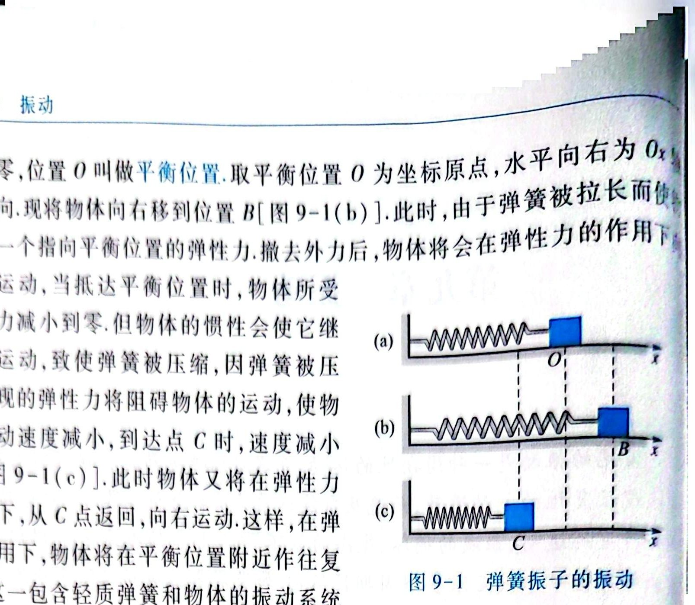

图9-1 弹簧振子的振动

由胡克定律可知,物体所受到的弹性力 F 与物体相对于平衡位置的位移 x 成正比,其方向与位移的方向相反,始终指向平衡位置,故此力常称为恢复力.于是有

$$
F = - k x
$$

式中比例常量 k 为弹簧的弹性系数, 它由弹簧本身的性质(材料、形状、大小等)所决定, 负号表示力与位移的方向相反. 根据牛顿第二定律, 物体的加速度为

$$
a = \frac {F}{m} = - \frac {k}{m} x\tag{9-1}
$$

对于一个给定的弹簧振子, $k$ 与 $m$ 都是常量, 而且都是正值, 其比值可用另一个常量 $\omega$ 的二次方表示, 即

$$
\frac {k}{m} = \omega^ {2}\tag{9-2}
$$

这样式(9-1)可写成

$$
a = - \omega^ {2} x\tag{9-3}
$$

上式说明,弹簧振子的加速度 a 与位移的大小 x 成正比,而且方向相反.人们把具有这种特征的振动叫做简谐振动.

式(9-3)也可写成

$$
\frac {\mathrm{d} ^ {2} x}{\mathrm{d} t ^ {2}} = - \omega^ {2} x\tag{9-4}
$$

这就是简谐振动的运动微分方程,其解为

本页另有从扫描件裁出的图：
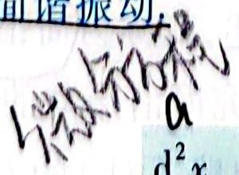

### 本页手写批注

- 【手写下划线】「平衡位置」「恢复力」。
- 【手写】在印刷公式旁重写 $F=-kx$。
- 【手写】式(9-2)旁注 $\omega=\sqrt{k/m}$（笔迹把 $\omega$ 写成类似 W 的字形，按上下文读作 $\omega$）。
- 【手写下划线】「简谐振动」定义句，并在式(9-4)旁描出 $\mathrm{d}^{2}x/\mathrm{d}t^{2}=-\omega^{2}x$。

## 扫描第 3 页

> 扫描页码：3 / 45。书中印刷页码见页眉（本页 OCR 未单独认出阿拉伯页码）；可见节号 9-1；页眉摘录：f 9-1 简谐振动振幅周期和频率相位 3 W 应方程 V x=Acos(wt+p) (9-5)。

$$
x = A \cos (\omega t + \varphi)\tag{9-5}
$$

它是简谐振动的运动方程,简称简谐振动方程.式中 A 和 $\varphi$ 是积分常量,它们的物理意义将在下面讨论.由上式可知,当物体作简谐振动时,其位移是时间的余弦函数 $^{①}$ .这也就是为什么把运动方程具有式(9-3)—式(9-5)形式的振动叫做简谐振动的原因.

将式(9-5)对时间求一阶、二阶导数,可分别得到简谐振动物体的速度 v 和加速度 a:

$$
v = \frac {\mathrm{d} x}{\mathrm{d} t} = - \omega A \sin (\omega t + \varphi)\tag{9-6}
$$

$$
a = \frac {\mathrm{d} ^ {2} x}{\mathrm{d} t ^ {2}} = - \omega^ {2} A \cos (\omega t + \varphi)\tag{9-7}
$$

由式(9-5)、式(9-6)和式(9-7)，可作出图9-2所示的x-t、v-t和a-t图.由图可以看出，物体作简谐振动时，它的位移、速度和加速度都是作相同周期性变化的.

现在我们来讨论式(9-5)中描述简谐振动特征的物理量 $A, \omega, (\omega t + \varphi)$ 及其相关概念: 振

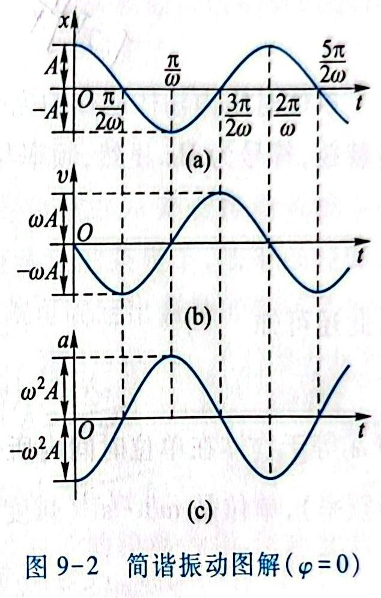

图 9-2 简谐振动图解 ( $\varphi = 0$ )

幅、周期(频率、角频率)和相位(初相位),其中相位的概念尤为重要.

### 二、振幅

在简谐振动方程 $x = A\cos (\omega t + \varphi)$ 中, 因为 $\cos (\omega t + \varphi)$ 的值在 $+1$ 和 $-1$ 之间, 所以物体的位移亦在 $+A$ 和 $-A$ 之间. 我们把简谐振动物体离开平衡位置最大位移的绝对值 $A$, 称为振幅.

### 三、周期和频率

物体作一次完全振动所经历的时间叫做振动的周期,用 T 表示,周期的单位名称是秒,符号为 s.例如在图 9-1 中,物体自位置 B 经 O 到达 C,然后再回到 B,所经历的时间就是一个周期.所以物体在任意时刻 t 的位移和速度,应与物体在时刻 $t+T$ 的位移和速度完全相同,于是有

$$
x = A \cos (\omega t + \varphi) = A \cos [ \omega (t + T) + \varphi ] = A \cos (\omega t + \varphi + \omega T)
$$

> 注：① 因为 $\cos (\omega t + \varphi) = \sin (\omega t + \varphi +\pi /2)$，若令 $\varphi^{\prime} = \varphi +\pi /2$，则式(9-5)可写成 $x = A\sin (\omega t + \varphi ')$. 所以也可以说，物体作简谐振动时，位移是时间的正弦函数. 单一的余弦或正弦函数都是简谐函数，但为统一起

本页另有从扫描件裁出的图：
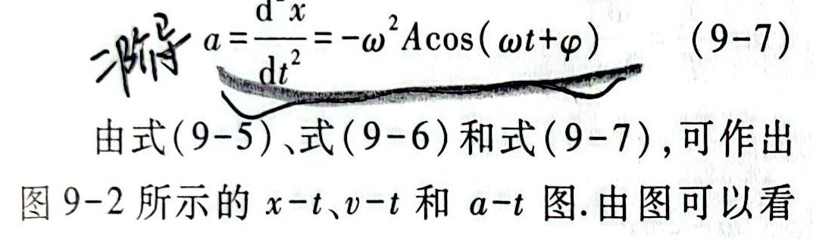

图9-2所示的x-t、u-t和a-t图.由图可以看
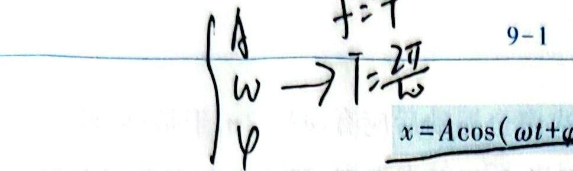

### 本页手写批注

- 【手写】页首左侧大括号，对照三个常量：$A$；$\omega\rightarrow T=2\pi/\omega$；$\varphi$；并写 $f=1/T$。
- 【手写下划线】式(9-5)，旁注「运动方程」。
- 【手写下划线】式(9-6)，旁注「速度」。
- 【手写下划线】式(9-7)，旁注「加速度」。

## 扫描第 4 页

> 扫描页码：4 / 45。书中印刷页码约 13；可见节号 9-4；页眉摘录：9-4简谐振动的能量 13 9-4 简谐振动的能量 船量守恒 我们仍以图9-1所示的弹簧振子为例。

9-4 简谐振动的能量

我们仍以图 9-1 所示的弹簧振子为例来说明简谐振动系统的能量. 设在某一时刻, 物体的速度为 v, 则系统的动能为

$$
E _ {\mathrm{k}} = \frac {1}{2} m v ^ {2} = \frac {1}{2} m \omega^ {2} A ^ {2} \sin^ {2} (\omega t + \varphi)\tag{9-20}
$$

若在该时刻物体的位移为 $x$ ，则系统的弹性势能为

$$
E _ {\mathrm{p}} = \frac {1}{2} k x ^ {2} = \frac {1}{2} k A ^ {2} \cos^ {2} (\omega t + \varphi)\tag{9-21}
$$

由以上两式可知,系统的动能和势能都随时间 t 作周期性的变化.当物体的位移最大时,势能达到最大值,但此时动能为零;当物体的位移为零时,势能为零,但动能却达到最大值.

系统的总能量为

$$
E = E _ {\mathrm{k}} + E _ {\mathrm{p}} = \frac {1}{2} m \omega^ {2} A ^ {2} \sin^ {2} (\omega t + \varphi) + \frac {1}{2} k A ^ {2} \cos^ {2} (\omega t + \varphi)
$$

因 $\omega^2 = k / m$ ，所以有

$$
E = \frac {1}{2} m \omega^ {2} A ^ {2} = \frac {1}{2} k A ^ {2}\tag{9-22}
$$

上式表明,弹簧振子作简谐振动的总能量与振幅及固有角频率的二次方成正比.由于在简谐振动过程中,只有系统的保守内力(如弹性力)做功,其他非保守内力和外力均不做功,所以系统作简谐振动的总能量必然守恒,即系统的动能 $E_{\mathrm{k}}$ 与势能 $E_{\mathrm{p}}$ 不断地相互转化,总能量却保持恒定,如图9-13所示(设 $\varphi = 0$ ).

> [插图：图9-13 弹簧振子的能量和时间的关系曲线 $(\varphi = 0

本页另有从扫描件裁出的图：
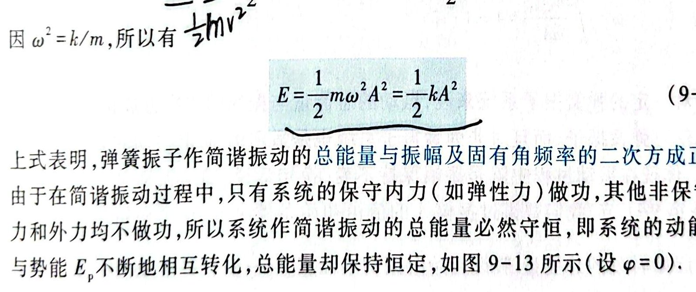

与势能E,不断地相互转化,总能量却保持恒定,如图 9-13所示(设∞=0).
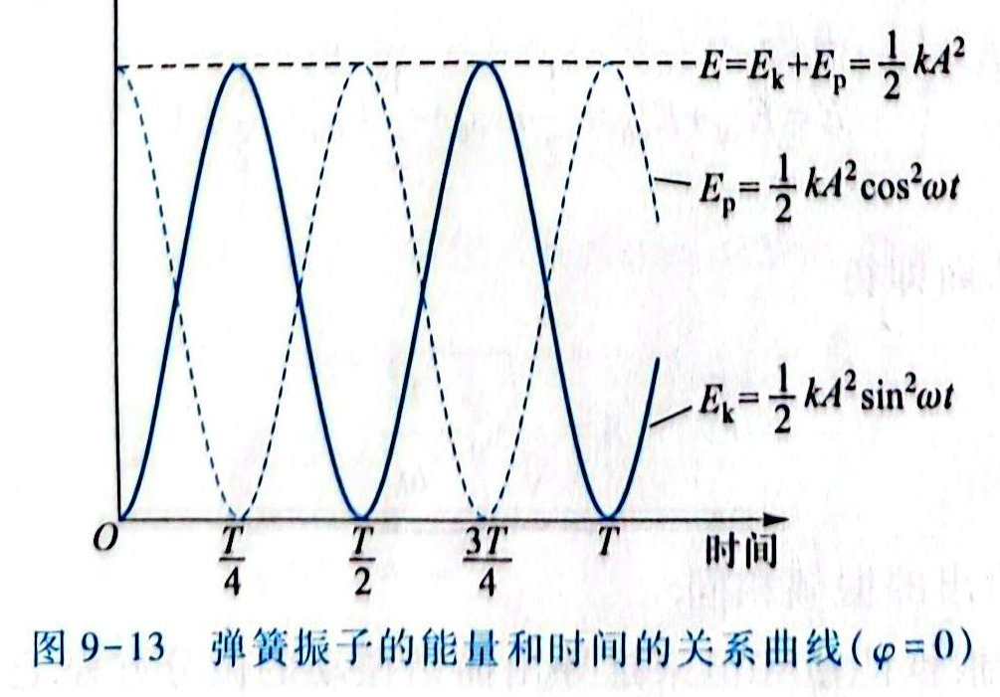

图9-13弹簧振子的能量和时间的关系曲线（=0）

### 本页手写批注

- 【手写】节标题「9-4 简谐振动的能量」旁注「能量守恒」。
- 【手写下划线】式(9-20)、式(9-21)、式(9-22)。
- 【手写】总能量式旁注 $\tfrac12 kA^{2}$；在 $\omega^{2}=k/m$ 旁注 $\tfrac12 mv^{2}$。

## 扫描第 5 页

> 扫描页码：5 / 45。书中印刷页码约 16；页眉含章名；页眉摘录：16 第九章振动 （2）从第n滴油滴滴人容器到第n+1滴油滴滴人容器，所经历的时间为质量为（m，。

2) 从第 $n$ 滴油滴滴入容器到第 $n + 1$ 滴油滴滴入容器, 所经历的时间为质量为 $(m' + nm)$ 的弹簧系统振动周期的 $1 / 2$, 所以有

$$
t = \frac {1}{2} T = \pi \sqrt {\frac {m ^ {\prime} + n m}{k}}
$$

## 9-5 简谐振动的合成

振动的合成有实际意义.例如,轮船中悬挂的钟摆在船体破浪行驶时,摆的运动就是多种振动合成的运动.一般的振动合成是比较复杂的,下面讨论几种简单的但属基本的简谐振动的合成,往往更为复杂的振动都可看作是由若干个或无限多个简谐振动合成而得.

### 一、两个同方向同频率简谐振动的合成

若两个同方向的简谐振动的角频率都是 $\omega$, 振幅分别为 $A_{1}$ 和 $A_{2}$, 初相分别为 $\varphi_{1}$ 和 $\varphi_{2}$, 则它们的振动方程分别为

$$
\begin{array}{l} x _ {1} = A _ {1} \cos (\omega t + \varphi_ {1}) \\ x _ {2} = A _ {2} \cos (\omega t + \varphi_ {2}) \end{array}
$$

因振动是同方向的,所以这两个简谐振动在任一时刻的合位移 x 仍应在同一直线上,而且等于这两个分振动位移的代数和,即

$$
x = x _ {1} + x _ {2}
$$

合位移 x 也可以用旋转矢量法求出. 如图 9-17 所示, 两分振动的旋转矢量分别为 $A_{1}$ 和 $A_{2}$ , 开始时 (t=0), 它们与 Ox 轴的夹角分别为 $\varphi_{1}$ 和 $\varphi_{2}$ , 在 Ox 轴上的投影分别为 $x_{1}$ 及 $x_{2}$ . 由平行四边形法则, 可得合矢量 $A = A_{1} + A_{2}$ . 由于 $A_{1}, A_{2}$ 以相同的 $\omega$ 绕点 O 作逆时针旋转, 它们的夹角 $(\varphi_{2} - \varphi_{1})$ 在旋转过程中保持不变, 所以矢量 A 的大小也保持不变, 并以相同的角速度 $\omega$ 绕点 O 作逆时针旋转. 从图9-17中可以看出,任一时刻合矢量A在Ox轴上的投影 $x=x_{1}+x_{2}$ ,因此合矢量A即为合振动所对应的旋转矢量,而开始时矢量A与Ox轴的夹角即为合振动的初相 $\varphi$ .由图可得合位移为

$$
x = A \cos (\omega t + \varphi)
$$

这就表明合振动仍是简谐振动,它的角频

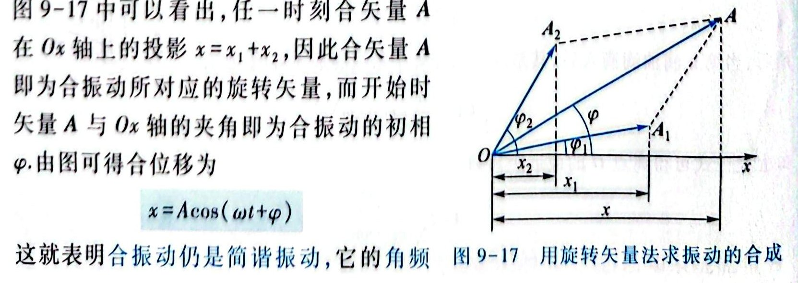

图9-17 用旋转矢量法求振动的合成

### 本页手写批注

- 【手写】页首例题公式左侧有演算，把 $t=\frac12 T=\pi\sqrt{(m'+nm)/k}$ 拆开书写；部分数字与字母重叠，以印刷公式为准，不另猜演算结果。
- 【手写下划线】「一、两个同方向同频率简谐振动的合成」，并画有箭头。

## 扫描第 6 页

> 扫描页码：6 / 45。书中印刷页码约 17；可见节号 9-5；页眉摘录：9-5简谐振动的合成 17 率与分振动的角频率相同，而其合振幅由平行四边形对角线求得： A= √。

率与分振动的角频率相同,而其合振幅由平行四边形对角线求得:

$$
A = \sqrt {A _ {1} ^ {2} + A _ {2} ^ {2} + 2 A _ {1} A _ {2} \cos (\varphi_ {2} - \varphi_ {1})}\tag{9-23}
$$

合振动的初相为

$$
\tan \varphi = \frac {A _ {1} \sin \varphi_ {1} + A _ {2} \sin \varphi_ {2}}{A _ {1} \cos \varphi_ {1} + A _ {2} \cos \varphi_ {2}}\tag{9-24}
$$

(1) 若相位差 $(\varphi_{2}-\varphi_{1})=2k\pi(k=0,\pm1,\pm2,\cdots)$ ，则

$$
A = \sqrt {A _ {1} ^ {2} + A _ {2} ^ {2} + 2 A _ {1} A _ {2}} = A _ {1} + A _ {2}\tag{9-25}
$$

即当两分振动的相位相同或相位差为 $2 \pi$ 的整数倍时, 合振幅等于两分振动的振幅之和, 合成结果为相互加强.

(2) 若相位差 $(\varphi_{2}-\varphi_{1})=(2k+1)\pi(k=0,\pm1,\pm2,\cdots)$ ，则

$$
A = \sqrt {A _ {1} ^ {2} + A _ {2} ^ {2} - 2 A _ {1} A _ {2}} = | A _ {1} - A _ {2} |\tag{9-26}
$$

即当两分振动的相位相反或相位差为 $\pi$ 的奇数倍时, 合振幅等于两分振动振幅之差的绝对值, 合成结果为相互减弱.

在一般情形下,相位差 $(\varphi_{2}-\varphi_{1})$ 可取任意值,而合振幅值则在 $A_{1}+A_{2}$ 和 $|A_{1}-A_{2}|$ 之间.

### 二、两个相互垂直同频率简谐振动的合成

设有两个相互垂直的同频率的简谐振动,它们分别在 x、y 轴上运动,其简谐振动方程为

$$
\begin{array}{l} x = A _ {1} \cos (\omega t + \varphi_ {1}) \\ y = A _ {2} \cos (\omega t + \varphi_ {2}) \end{array}
$$

将上两式中的 t 消去, 可得到合振动的轨迹方程:

$$
\frac {x ^ {2}}{A _ {1} ^ {2}} + \frac {y ^ {2}}{A _ {2} ^ {2}} - \frac {2 x y}{A _ {1} A _ {2}} \cos (\varphi_ {2} - \varphi_ {1}) = \sin^ {2} (\varphi_ {2} - \varphi_ {1})\tag{9-27}
$$

这是一个椭圆方程,它的形状由两分振动的振幅及相位差 $\varphi_{2}-\varphi_{1}$ 的值决定.下面讨论几种特殊情况

若相位差 $\Delta \varphi = \varphi_{2} - \varphi_{1} = 0$ ，则式(9-27)写为

$$
y = \frac{A_2}{A_1} x
$$

（扫描页在此式之后截断。）

### 本页手写批注

- 【手写下划线】式(9-23)、式(9-24)、式(9-25)、式(9-26)、式(9-27)。
- 【手写】式(9-25)旁注「同向」。
- 【手写】式(9-26)旁注「反向」。
- 【手写圈出】小节标题中的「垂直」。
- 【手写圈出】式(9-27)旁注「椭圆轨迹」。

## 扫描第 7 页

> 扫描页码：7 / 45。书中印刷页码约 18；页眉含章名；可见节号 9-1；页眉摘录：18 第九章振动 此时合振动的轨迹是一条通过坐标原点的直线,其斜率等于两个分振动振幅之 比[图9。

此时合振动的轨迹是一条通过坐标原点的直线,其斜率等于两个分振动振幅之比[图9-18(a)、(b)].

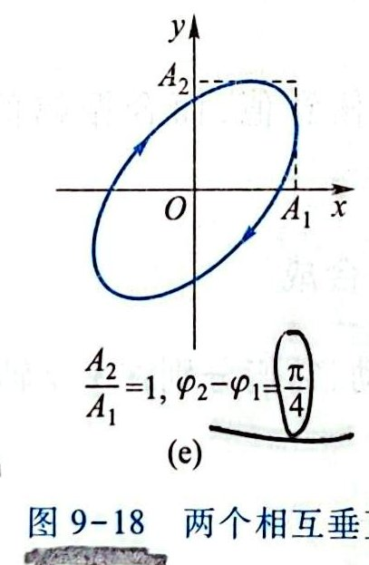

图9-18 两个相互垂直的同频率的简谐振动的合成

若 $\Delta \varphi = \varphi_{2} - \varphi_{1} = \pi /2$ ，则式(9-27)写为

$$
\frac {x ^ {2}}{A _ {1} ^ {2}} + \frac {y ^ {2}}{A _ {2} ^ {2}} = 1
$$

合振动的轨迹为一正椭圆[图9-18(d)].当 $A_{1} = A_{2}$ 时，上式变为圆方程，合振动的轨迹为一圆[图9-18(c)].

两个分振动的相位差为 $\pi / 4$ 时, 合振动的轨迹为斜椭圆 [图 9-18(e)、(f)].

现在我们借助旋转矢量,用作图法来描绘

本页另有从扫描件裁出的图：
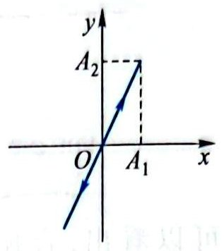
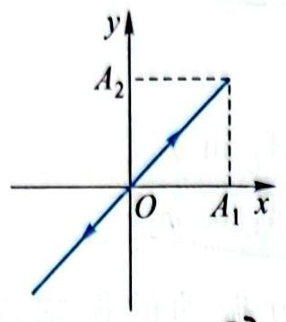
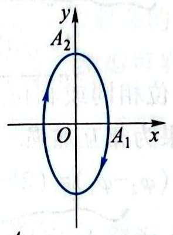
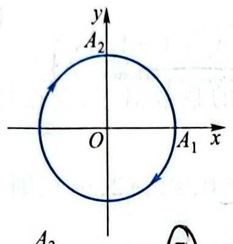
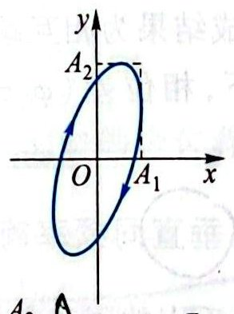

### 本页手写批注

- 【手写圈出】图 9-18(a) 至 (f) 各分图上的相位差条件。
- 【手写圈出】圆的轨迹方程 $\dfrac{x^{2}}{A_{1}^{2}}+\dfrac{y^{2}}{A_{2}^{2}}=1$。
- 【手写】图 9-18 左下方有一行潦草笔迹，【无法辨认】。

## 扫描第 8 页

> 扫描页码：8 / 45。书中印刷页码约 22；页眉含章名；可见节号 9-2；页眉摘录：22 第九章振动 动的振幅分别为A,和A（=A,）,初相分别为,和2,角频率分别为∞,和, 设@。

动的振幅分别为 $A_{1}$ 和 $A_{2}(= A_{1})$, 初相分别为 $\varphi_{1}$ 和 $\varphi_{2}$, 角频率分别为 $\omega_{1}$ 和 $\omega_{2}$, 并设 $\omega_{2} > \omega_{1}$, 且呈简单的两整数比 (图9-23). 图(a)和图(b)分别表示两个分振动的位移-时间曲线, 图(c)表示合振动的位移-时间曲线. 由图可知, 在 $t_{1}$ 时刻, 两分振动的相位相同, 合振幅最大; 在 $t_{2}$ 时刻, 两分振动的相位相反, 合振幅最小;在 $t_{3}$ 时刻, 两分振动的相位相同, 合振幅又最大. 图(c)中的虚线表示合振动的振幅随时间作周期性缓慢变化. 这种频率较大而频率之差很小的两个同方向简谐振动合成时, 其合振动的振幅时而加强时而减弱的现象叫做拍. 下面从合振动方程出发对拍现象作定量讨论.

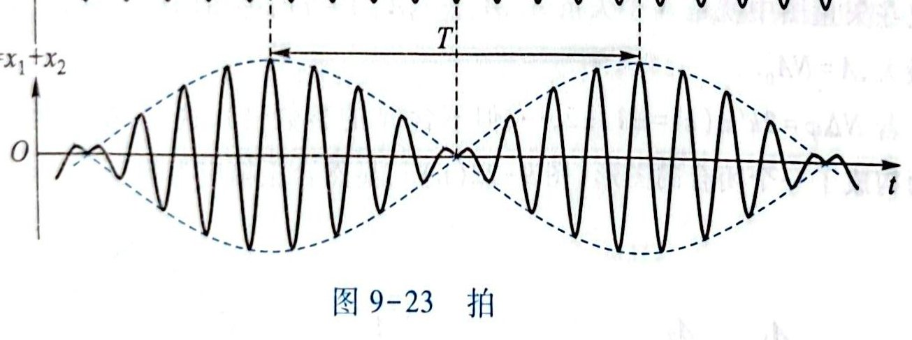

图9-23 拍

设两简谐振动不仅振幅相同 $\left(A

$$
\begin{array}{l} x _ {1} = A _ {1} \cos \omega_ {1} t = A _ {1} \cos 2 \pi \nu_ {1} t \\ x _ {2} = A _ {2} \cos \omega_ {2} t = A _ {2} \cos 2 \pi \nu_ {2} t \end{array}
$$

合振动的位移为

$$
x = x _ {1} + x _ {2} = A _ {1} \cos 2 \pi \nu_ {1} t + A _ {2} \cos 2 \pi \nu_ {2} t
$$

已知 $A_{1} = A_{2}$, 故合振动的振动方程为

$$
x = \left(2 A _ {1} \cos 2 \pi \frac {\nu_ {2} - \nu_ {1}}{2} t\right) \cos 2 \pi \frac {\nu_ {2} + \nu_ {1}}{2} t\tag{9-29}
$$

由于 $|\nu_{2}-\nu_{1}|\ll(\nu_{2}+\nu_{1})$，因此可将式中 $\dfrac{\nu_{2}+\nu_{1}}{2}$ 看成是合振动的频率，$\left|2A_{1}\cos 2\pi\dfrac{\nu_{2}-\nu_{1}}{2}t\right|$ 看成是合振动的振幅。这样，合振动的振幅随时间作缓慢的周（扫描页在此截断，后半句在扫描第 9 页）。

本页另有从扫描件裁出的图：
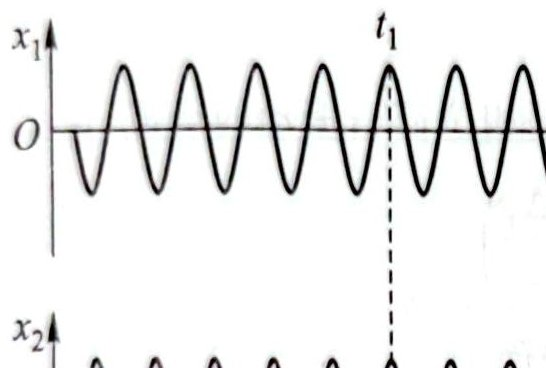
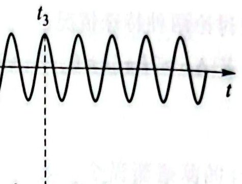

### 本页手写批注

- 【手写下划线】拍的定义句。
- 【手写圈出】「频率较大而频率之差很小」和「拍」。
- 【手写】式(9-29)两个括号旁分别注「振幅」「合振动频率」，并下划线该式。

## 扫描第 9 页

> 扫描页码：9 / 45。书中印刷页码约 23；可见节号 9-6；页眉摘录：9-6阻尼振动受迫振动共振 23 期性变化,从而出现振幅时大时小的现象，合振幅在0~2A,范围内。

期性变化,从而出现振幅时大时小的现象,合振幅在 $0 \sim 2A_{1}$ 范围内.因为余弦函数的绝对值以 $\pi$ 为周期,所以有

$$
\begin{array}{r l} \left| 2 A _ {1} \cos 2 \pi \frac {\nu_ {2} - \nu_ {1}}{2} t \right| & = \left| 2 A _ {1} \cos \left(2 \pi \frac {\nu_ {2} - \nu_ {1}}{2} t + \pi\right) \right| \\ & = \left| 2 A _ {1} \cos 2 \pi \frac {\nu_ {2} - \nu_ {1}}{2} \left(t + \frac {1}{\nu_ {2} - \nu_ {1}}\right) \right| \end{array}
$$

可见,合振幅变化的周期 $T=1/(\nu_{2}-\nu_{1})$ . 因此合振幅变化的频率,即拍频为

$$
\nu = \nu_ {2} - \nu_ {1}\tag{9-30}
$$

拍频为两个分振动的频率之差.

上述结果也可用旋转矢量合成法求得.在图9-24中,因为 $A_{1}$ 和 $A_{2}$ 的角速度不同,所以在旋转过程中, $A_{1}$ 和 $A_{2}$ 的方向有时一致,合振幅最大;有时相反,合振幅最小.设 $\omega_{2}>\omega_{1}$ ,则 $A_{2}$ 相对于 $A_{1}$ 的旋转角速度为 $\omega_{2}-\omega_{1}$ ,那么, $A_{2}$ 前后相邻两次与 $A_{1}$ 方向一致时所需的时间 $T=\frac{2\pi}{\omega_{2}-\omega_{1}}=\frac{1}{\nu_{2}-\nu_{1}}$ ,T为相邻两次振动最强之间的时间(图9- $\nu=\frac{1}{T}=\nu_{2}-\nu_{1}$ .

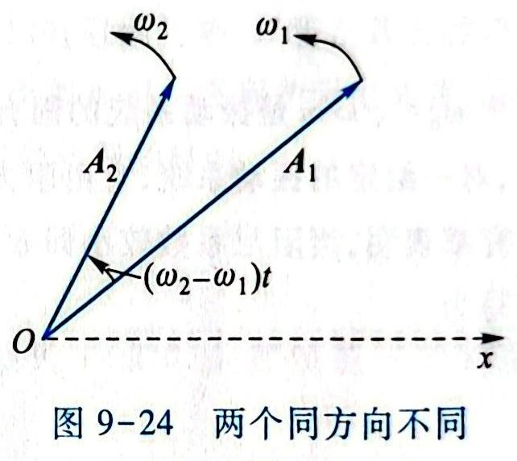

图9-24 两个同方向不同频率简谐振动的合成

$\frac{1}{\nu_{2}-\nu_{1}}, T$ 为相邻两次振动最强之间的时间(图9-23)，亦即拍的周期.因此，拍频 $\nu = \frac{1}{T} = \nu_{2} - \nu_{1}$对于两个频率相近的振动,若其中一个振动频率已知,那么通过拍频的测量就可以知道另一个待测振动的频率.例如,乐队里的“定音”就是根据此法.此法在声学、速度测量、无线电技术和卫星跟踪等领域也得到了应用.

## \*9-6 阻尼振动 受迫振动 共振

### 一、阻尼振动

前面所讨论的简谐振动,在振动过程中系统的机械能是守恒的,是一种无阻尼的自由振

本页另有从扫描件裁出的图：
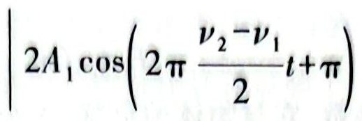

### 本页手写批注

- 【手写圈出】拍频 $\nu=\nu_{2}-\nu_{1}$。

## 扫描第 10 页

> 扫描页码：10 / 45。书中印刷页码约 45；可见节号 10-1；页眉摘录：10-1机械波的几个概念 45 二、横波与纵波 按照质元振动方向和波的传播方向的关系，机械波可分。

按照质元振动方向和波的传播方向的关系,机械波可分为横波与纵波,这是波动的两种最基本的形式.

为什么要了解波动形式？因为不同的波动形式对应不同的产生机理,不同的机理会导致波的不同传播速度,甚至会影响到合成波的性质.例如,水面波是横波与纵波合成的椭圆波.

如图 10-1(a) 所示,用手握住一根绷紧的长绳,当手上下抖动时,绳子上各部分质元就依次上下振动起来,这种质元振动方向与波的传播方向相垂直的波,称为横波.对于横波,你将会在绳子上看到交替出现凸起的波峰和凹下的波谷,并且它们以一定的速度沿绳传播,这就是横波的外形特征.

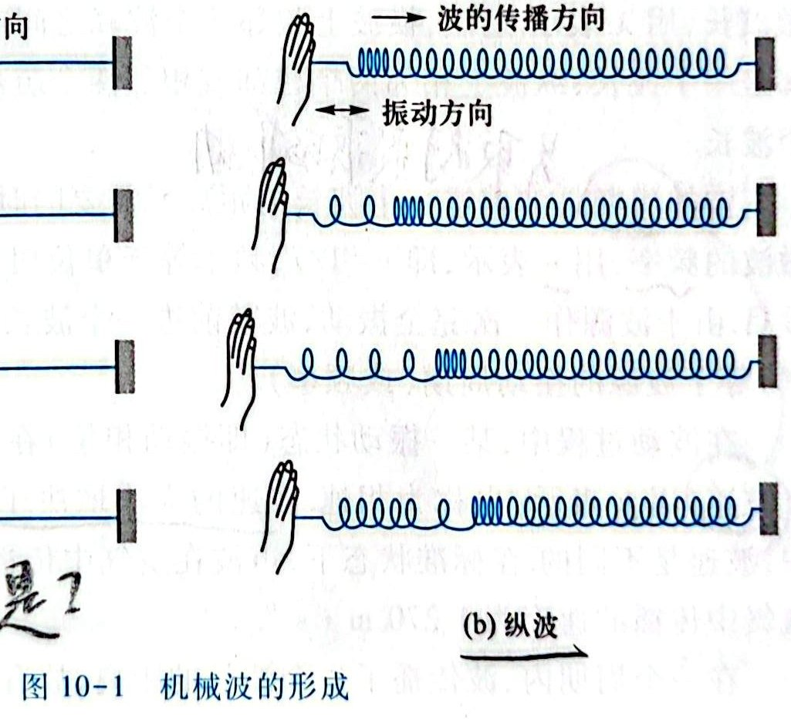

图10-1 机械波的形成

将一根水平放置的长弹簧的一端固定起来,用手去拍打另一端,各部分弹簧就依次左右振动起来,如图10-1(b)所示.这种各质元的振动方向与波的传播方向相互平行的波,称为纵波.纵波的外形特征是弹簧出现交替的“稀疏”和“稠密”区域,并且它们以一定的速度传播出去.

从图 10-1 中还可以看出,无论是横波还是纵波,它们都只是振动状态(即振动相位)的传播,弹性介质中各质元仅在各自的平衡位置附近振动,并没有随振动的传播而移走

本页另有从扫描件裁出的图：
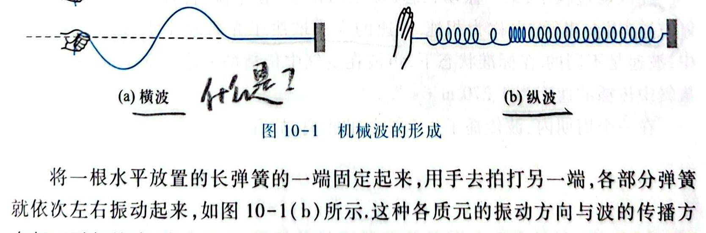

就依次左右振动起来，如图10-1（b)所示.这种各质元的振动方向与波的传播方

### 本页手写批注

- 【手写下划线】「横波」「纵波」，以及纵波外形特征中的「稀疏」和「稠密」。
- 【手写】图 10-1(a) 横波图旁注「什么是？」，指向横波示意。

## 扫描第 11 页

> 扫描页码：11 / 45。书中印刷页码约 46；页眉含章名；页眉摘录：46 第十章波动 进一步说、在弹性介质中形成横波时，必是一层介质相对于另一层介质 横向的平移，即。

进一步说,在弹性介质中形成横波时,必是一层介质相对于另一层介质发生横向的平移,即发生切变.由于固体会产生切变,因此横波能在固体中传播.而在弹性介质中形成纵波时,介质要发生压缩或拉伸,即发生体变(也称容变),固体、液体和气体都会产生体变,因此,纵波可以在固体、液体和气体中传播.顺便指出,水的表面波的形成原因是比较复杂的,不能简单地归入基本的横波或纵波.然而,任何复杂形式的波动,都可以看成是横波和纵波的叠加,水表面的质元既受弹性力又受准弹性力的作用,但它仍是在平衡位置附近作某种形式的振动,而这种振动也是以一定速度传播开去形成波动的.本课程主要研究波动的共性和基本规律,对像水的表面波这样较复杂形式的波动,也是着眼于它们的共性,而不是去细究其特性.

### 三、波长 波的周期和频率 波速

波长、波的周期(或频率)和波速都是描述波动的重要物理量.沿波传播方向两个相邻的、相位差为 $2 \pi$ 的振动质元之间的距离,即一个完整波形的长度,叫做波长,用 $\lambda$ 表示.显然,横波上相邻两个波峰之间或相邻两个波谷之间的距离,都是一个波长;纵波上相邻两个密部或相邻两个疏部对应点之间的距离,也是一个波长.

波的周期是波前进一个波长的距离所需要的时间,用 T 表示. 周期的倒数叫做波的频率,用 $\nu$ 表示,即 $\nu = 1/T$ , 频率等于单位时间内波动所传播的完整波的数目. 由于波源作一次完全振动, 波就前进一个波长的距离, 所以波的周期(或频率)等于波源的振动周期(或频率).

在波动过程中,某一振动状态(即振动相位)在单位时间内所传播的距离叫做波速,用 u 表示,也称为相速.波速的大小取决于介质的性质,在不同的介质中,波速是不同的.在标准状态下,声波在空气中传播的速度为 $331 \, m \cdot s^{-1}$ , 而在氢气中传播的速度为 $1270 \, m \cdot s^{-1}$ .

在一个周期内,波传播了一个波长的距离,故有

$$
u = \frac {\lambda}{T}\tag{10-1}
$$

或

$$
u = \lambda \nu\tag{10-2}
$$

以上两式具有普遍的意义,对各类波都适用

### 本页手写批注

- 【手写下划线】「波长」「频率」「波速」。
- 【手写】波长定义旁注「又取对波源的振动」。
- 【手写】左侧大括号强调 $u=\lambda/T=\lambda\nu$。

## 扫描第 12 页

> 扫描页码：12 / 45。书中印刷页码约 50；页眉含章名；页眉摘录：50 第十章波动 质元作简谐振动，为简便计，设其初相为零，故其运动方程为 y=Acos(or+)。

质元作简谐振动, 为简便计, 设其初相为零, 故其运动方程为

$$
y _ {o} = A \cos \omega t
$$

式中 $y_{0}$ 是质元在 $t$ 时刻相对平衡位置的位移, $A$ 是振幅, $\omega$ 是角频率. 假定介质是均匀的、无吸收的, 那么各点的振幅将保持不变. 为了找出在 $Ox$ 轴上所有质元在任一时刻 $t$ 的位移, 我们可在 $Ox$ 轴正方向上任取一点 $P$, 它距点 $O$ 的距离为 $x$. 显然, 当振动从点 $O$ 传播到点 $P$ 时, 点 $P$ 将以相同的振幅和频率

> [插图：图10-4 平面简谐波]

重复点 $O$ 的振动.但振动从点 $O$ 传播到点 $P$ 需经历时间为 $t_0 = x / u (u$ 为波速).这表明点 $O$ 在时刻 $t$ 的振动状态,要在时刻 $t + t_0$ 才能传到点 $P$.换言之,点 $P$ 在时刻 $t$ 的振动状态,是点 $O$ 在时刻 $t - t_0$ 的振动状态.于是点 $P$ 在时刻 $t$ 的位移为

$$
y _ {P} = A \cos \omega \left(t - \frac {x}{u}\right)\tag{10-3a}
$$

无须细说,此式显然适用于表述 $Ox$ 轴上所有质元的振动,从而可以描绘出 $Ox$ 轴上各点位移随时间变化的整体图像,因此,上式即为沿 $Ox$ 轴正方向传播的平面简谐波的波函数,也常称为平面简谐波的波动方程.

因为 $\omega=2\pi/T=2\pi\nu, u=\lambda\nu=\lambda/T$ ，所以通常式(10-3a)可写成

$$
y = A \cos 2 \pi \left(\frac {t}{T} - \frac {x}{\lambda}\right)\tag{10-3b}
$$

由于 $t = nT$ 时, 振动传播的距离 $x = n\lambda$, 所以式 (10-3b) 中的 $t / T$ 与 $x / \lambda$ 地位相当, 因此 $\lambda$ 亦可称为空间周期.

如取 $k = 2\pi /\lambda ,k$ 称为角波数，则波函数又可写成

$$
y = A \cos (\omega t - k x)\tag{10-3c}
$$

如果波沿 $Ox$ 轴负方向传播, 则点 $P$ 的振动比点 $O$ 早开始一段时间 $x / u$, 也就是说, 当点 $O$ 的相位是 $\omega t$ 时, 点 $P$ 的相位已是 $\omega(t + x / u)$. 所以点 $P$ 在任一时刻的位移为

$$
y = A \cos \omega \left(t + \frac {x}{u}\right)\tag{10-4a}
$$

这就是沿 $Ox$ 轴负方向传播的平面简谐波的波函数, 并且同样也可写成以下两种常用的形式

本页另有从扫描件裁出的图：
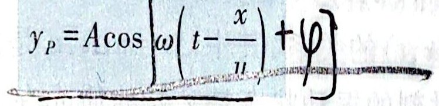
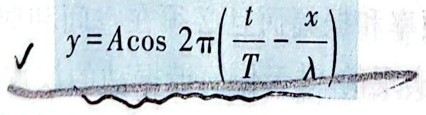

### 本页手写批注

- 【手写下划线】$y_{0}=A\cos\omega t$，以及「平面简谐波的波函数」「平面简谐波的波动方程」。
- 【手写】式(10-3a)(10-3b)(10-3c) 旁打勾；式(10-3a) 的括号外补写 $+\varphi$（印刷式在设初相为零时未写出 $\varphi$）。
- 【手写】图 10-4 旁注「$u$ 为波速」。
- 【手写下划线】负向传播的式(10-4a)。

## 扫描第 13 页

> 扫描页码：13 / 45。书中印刷页码约 51；可见节号 10-2；页眉摘录：10-2平面简谐波的波函数 51 y=Acos 2π (10-4b) y=Acos(wt+kx)。

$$
y = A \cos 2 \pi \left(\frac {t}{T} + \frac {x}{\lambda}\right)\tag{10-4b}
$$

$$
y = A \cos (\omega t + k x)\tag{10-4c}
$$

至此,不难将以上的讨论推广到更一般的情形.若波沿 $Ox$ 轴的正方向传播,且已知距点 $O$ 距离为 $x_0$ 的点 $Q$ 的振动规律为

$$
y _ {Q} = A \cos (\omega t + \varphi)
$$

则相应的波函数为

$$
y = A \cos \left[ \omega \left(t - \frac {x - x _ {0}}{u}\right) + \varphi \right]\tag{10-5}
$$

不难看出式(10-3)、式(10-4)、式(10-5)皆满足一般波函数关系式 $y(x+\Delta x,t+\Delta t)=y(x,t)$ .

### 二、波函数的物理含义

为了帮助大家理解波函数的物理含义,不妨以式(10-3)为例作一番研讨.

(1) 当 $x$ 一定时 (相当于对某一质元用摄影机拍摄), 则 $y$ 仅为时间 $t$ 的函数. 此时式 (10-3) 表示的是距原点 $O$ 为 $x$ 处的质元在不同时刻的位移, 即该质元作简谐振动的情况. 以 $y$ 为纵坐标, $t$ 为横坐标, 可得如图 10-5 所示的波线上不同质元的 $y - t$ 曲线. 从这些曲线可以看出, 它们的初相位依次为 $0, -\pi / 2, -\pi, -3\pi / 2, -2\pi$. 就是说 $x = \lambda / 4$ 处质元的相位比 $x = 0$ 处质元的相位落后 $\pi / 2$, 其他质元则依次又落后 $\pi / 2$.

(2) 当 $t$ 一定时 (相当于对各个质元用照相机拍摄), $Ox$ 轴上所有质元的位移 $y$ 仅为 $x$ 的函数. 此时, 式 (10-3) 表示了给定时刻各质元的位移分布情况. 以 $y$ 为纵坐标, $x$ 为横坐标, 可得如图 10-6 所示的不同时刻的 $y - x$ 曲线, 该曲线称为波形图. 从波形图可以看出, 经过一个周期的时间, 波向前传播了一个波长的距离.

从波形图中可看出,在同一时刻,距离波源 O 分别为 $x_{1}$ 和 $x_{2}$ 的两质元的相位是不同的.由式(10-3)可得两质元的相位分别为

本页另有从扫描件裁出的图：
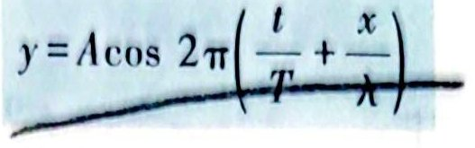
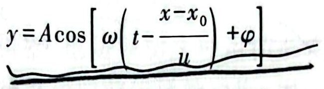

### 本页手写批注

- 【手写下划线】式(10-4b)、式(10-4c)。
- 【手写圈出】「则相应的波函数为」。
- 【手写】式(10-5) 旁注 $\varphi=0$，并在式前打叉，表示此处讨论的一般式与前面初相为零的式子要分开。

## 扫描第 14 页

> 扫描页码：14 / 45。书中印刷页码约 56；页眉含章名；页眉摘录：56 第十章波动 若它的左端发生了位移y,右端位移为y+dy,这表明它不仅发生了运动，而 能为 。

若它的左端发生了位移 $y$, 右端位移为 $y + \mathrm{d}y$, 这表明它不仅发生了运动, 而且还发生了被拉长 $\mathrm{dy}$ 的形变, 所以它应同时具有了振动动能和弹性势能. 其振动动能为

> [插图：图10-11 棒中的纵波]

$$
\mathrm{d} W _ {\mathrm{k}} = \frac {1}{2} (\mathrm{dm}) v ^ {2}
$$

而由式(10-3a)，该体积元的振动速度为

$$
v = \frac {\partial y}{\partial t} = - A \omega \sin \omega \left(t - \frac {x}{u}\right)
$$

所以

$$
\mathrm{d} W _ {\mathrm{k}} = \frac {1}{2} (\rho \mathrm{d} V) A ^ {2} \omega^ {2} \sin^ {2} \omega \left(t - \frac {x}{u}\right)\tag{10-7}
$$

同时,体积元因形变而具有弹性势能 $\mathrm{d}W_{\mathrm{p}} = k(\mathrm{dy})^{2} / 2$, 此处 $k$ 为棒的弹性系数, 而 $k$ 与弹性模量 $E$ 的关系为 $k = SE / \mathrm{dx}$. 于是弹性势能为

$$
\mathrm{d} W _ {\mathrm{p}} = \frac {1}{2} k (\mathrm{dy}) ^ {2} = \frac {1}{2} E S \mathrm{dx} \left(\frac {\mathrm{dy}}{\mathrm{dx}}\right) ^ {2}
$$

式中 $S \mathrm{~d} x$ 为体积元的体积 $\mathrm{d} V$, 再利用纵波速度 $u = \sqrt {E / \rho}$, 上式可改写为

$$
\mathrm{d} W _ {\mathrm{p}} = \frac {1}{2} \rho u ^ {2} \mathrm{d} V \left(\frac {\mathrm{d} y}{\mathrm{d} x}\right) ^ {2}
$$

现在考虑到 $y$ 是 $x$ 和 $t$ 的函数, 故上式中 $\mathrm{dy} / \mathrm{dx}$ 应是 $y$ 对 $x$ 的偏导数, 于是有

$$
\mathrm{d} W _ {\mathrm{p}} = \frac {1}{2} \rho u ^ {2} \mathrm{d} V \left(\frac {\partial y}{\partial x}\right) ^ {2}\tag{10-8}
$$

而根据式(10-3a)，有

$$
\frac {\partial y}{\partial x} = A \frac {\omega}{u} \sin \omega \left(t - \frac {x}{u}\right)
$$

因此，式(10-8)可写成

$$
\mathrm{d} W _ {\mathrm{p}} = \frac {1}{2} (\rho \mathrm{d} V) A ^ {2} \omega^ {2} \sin^ {2} \omega \left(t - \frac {x}{u}\right)\tag{10-9}
$$

比较式(10-7)和式(10-9)，可见 $dW_{k}=dW_{p}$ ，即两者时时相等 $^{①}$ .

体积元的总能量为其动能和势能之和, 即 $\mathrm{d}W = \mathrm{d}W_{\mathrm{k}} + \mathrm{d}W_{\mathrm{p}}$, 所以

$$
\mathrm{d} W = (\rho \mathrm{d} V) A ^ {2} \omega^ {2} \sin^ {2} \omega \left(t - \frac {x}{u}\right)\tag{10-10}
$$

> 注：① 势能零点选在平衡位置才有如此结论

本页另有从扫描件裁出的图：
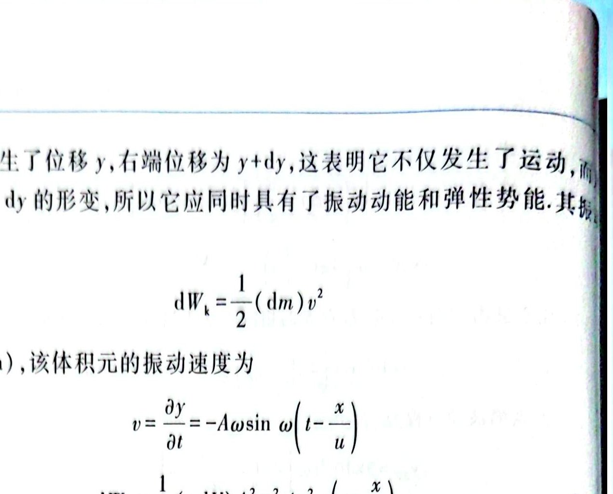
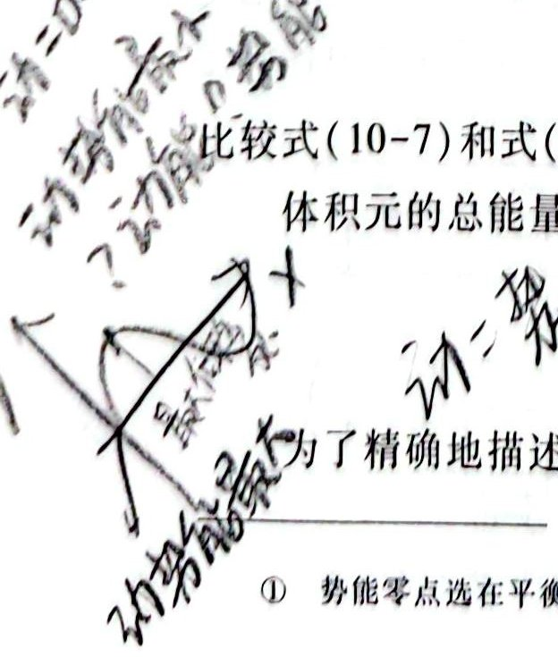

### 本页手写批注

- 【手写】页下左方有大段斜写批注，讨论动能、势能与总能量；墨迹重叠，【无法辨认】完整句子，不据笔迹改印刷公式。

## 扫描第 15 页

> 扫描页码：15 / 45。书中印刷页码约 67；可见节号 10-5；页眉摘录：10-5驻波 67 y,=Acos 2 y2=Acos 2π vt+ x 式中A 为波的振幅,v。

式中 $A$ 为波的振幅, $\nu$ 为频率, $\lambda$ 为波长.两波在任意点处任意时刻叠加产生的合位移为

$$
y = y _ {1} + y _ {2} = A \cos 2 \pi \left(\nu t - \frac {x}{\lambda}\right) + A \cos 2 \pi \left(\nu t + \frac {x}{\lambda}\right)
$$

应用三角关系式,上式可化为

$$
y = 2 A \cos 2 \pi \frac {x}{\lambda} \cos 2 \pi \nu t\tag{10-17}
$$

这就是驻波的波函数,显然此式并不满足行波方程条件 $y(x+u\Delta t,t+\Delta t)=y(x,t)$ ,因而常称为驻波方程,式中 $2A\cos(2\pi x/\lambda)$ 是各点的振幅,它只与x有关,即各点的振幅随着其与原点的距离x的不同而异.上式表明,当形成驻波时,弦线上的各点作振幅为 $\left|2A\cos(2\pi x/\lambda)\right|$ 、频率皆为 $\nu$ 的简谐振动.

下面对驻波方程作进一步的讨论.

**1. 波节和波腹**

因弦线上各点作振幅为 $|2A\cos (2\pi x / \lambda)|$ 的简谐振动, 所以凡满足 $\cos (2\pi x / \lambda) = 0$ 的那些点, 振幅都为零, 这些点始终静止不动, 叫做波节 (图10-24中由 $N$ 表示的各点); 而满足 $|\cos (2\pi x / \lambda)| = 1$ 的那些点, 它们的振幅最大, 等于 $2A$, 这些点振动最强, 叫做波腹 (图10-24中由 $L$ 表示的各点); 弦线上其余各点的振幅在零与最大值之间. 下面讨论波节、波腹的位置. 因在波节处

$$
\cos 2 \pi \frac {x}{\lambda} = 0
$$

有

$$
2 \pi \frac {x}{\lambda} = \pm (2 k + 1) \frac {\pi}{2}
$$

所以波节的位置为

$$
x = \pm (2 k + 1) \frac {\lambda}{4}, \quad k = 0, 1, 2, \dots\tag{10-18}
$$

相邻两波节之间的距离为

本页另有从扫描件裁出的图：
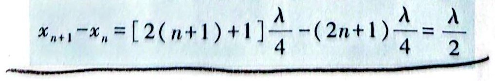

### 本页手写批注

- 本页可见手写较少，主要为印刷的驻波公式。未把无法确认的浅痕写成文字。

## 扫描第 16 页

> 扫描页码：16 / 45。书中印刷页码约 72；页眉含章名；可见节号 10-3；页眉摘录：72 第十章波动 反=10-3cos 200π （2）y=yx+y反=2x10²cos|πx+ 。

y _ {\text {反}} = 10 ^ {- 3} \cos \left[ 200 \pi \left(t + \frac {x}{200}\right) + \frac {\pi}{2} \right]
$$

$$
y = y _ {\text {入}} + y _ {\text {反}} = 2 \times 10 ^ {- 3} \cos \left(\pi x + \frac {\pi}{4}\right) \cos \left(200 \pi t + \frac {\pi}{4}\right). \tag {2}
$$

(3) 令

$$
\cos \left(\pi x + \frac {\pi}{4}\right) = 0
$$

得波节坐标

$$
x _ {\text {节}} = n + \frac {1}{4}, \quad n = 0, 1, 2, \dots
$$

由于 $x \leqslant L = 2.25 \mathrm{~m}$ 的限制，故 $x_{\text{节}} = 0.25 \mathrm{~m}, 1.25 \mathrm{~m}, 2.25 \mathrm{~m}$. 令

$$
\left| \cos \left(\pi x + \frac {\pi}{4}\right) \right| = 1
$$

得波腹坐标

$$
x _ {\text {腹}} = n - \frac {1}{4}, \quad n = 1, 2, \dots
$$

同样由于 $x \leqslant 2.25 \mathrm{~m}$, 故 $x_{\text{腹}} = 0.75 \mathrm{~m}, 1.75 \mathrm{~m}$.

## 10-6 多普勒效应

迄今为止,我们所讨论的都是波源与观察者相对介质静止的情况,因此观察者接收到的频率与波源振动的频率是相同的.如果波源或观察者或两者都相对于介质运动,那么观察者接收到的频率与波源振动的频率就不相同了,这种现象叫做多普勒效应①.在日常生活中可以发现,当高速行驶的救护车或消防车鸣笛而来时,人们听到的汽笛音调变高,即频率变大;反之,当救护车或消防车鸣笛离去时,人们听到的音调变低,即频率变小,这就是声波的多普勒效应.

首先要把波源的频率、观察者接收到的频率和波的频率分清楚:波源的频率 $\nu$ , 是波源在单位时间内振动的次数, 或在单位时间内发出完整波的数目; 观察者接收到的频率 $\nu'$ , 是观察者在单位时间内接收到的振动次数或完整波数; 而波的频率 $\nu_{b}$ , 则是介质内质点在单位时间内振动的次数, 或单位时间内通过介质中某点的完整波数, 并且 $\nu_{b}=u/\lambda_{b}$ , 其中 u 为介质中的波速, $\lambda_{b}$ 为介质中的波长. 这三个频率可能互不相同, 下面分几种情况进行讨论. 为简单起见, 只讨论波源和观察者沿着它们的连线相对介质运动的情形.

> 注：① 多普勒(C.Doppler,1803—1853,奥地利物理学家)于1842年第一次论证了相互转动的双星系统所发射的光的频率的微小变化,继而又讨论了声源与观察者之间相对运动时,观察者所接收的声波频率的变化.声与光都有多普勒效应.本书第十四章将介绍波源的速度接近光速时的多普勒效应

本页另有从扫描件裁出的图：
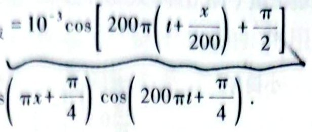

### 本页手写批注

- 本页印刷正文已按扫描转录。手写主要是下划线或页边短注；除能确认的记号外，不把潦草笔迹猜成公式。

## 扫描第 17 页

> 扫描页码：17 / 45。书中印刷页码约 73；可见节号 10-6；页眉摘录：10-6多普勒效应 73 波源和观察者沿着它们的连线相对介质运动的情形. 一、波源不动，观察者相。

波源和观察者沿着它们的连线相对介质运动的情形.

> 注：① 多普勒(C.Doppler,1803—1853,奥地利物理学家)于1842年第一次论证了相互转动的双星系统所发射的光的频率的微小变化,继而又讨论了声源与观察者之间相对运动时,观察者所接收的声波频率的变化.声与光都有多普勒效应.本书第十四章将介绍波源的速度接近光速时的多普勒效应.

### 一、波源不动, 观察者相对介质以速度 $v_{0}$ 运动

观察者在点 P 向着波源(点 S)运动. 如图 10-29 所示, 先假定观察者不动,波以速度 u 向着 P 传播, dt 时间内波传播的距离为 u dt, 观察者接收到的完整波数, 即为分布在距离 u dt 中的波数. 而现在观察者是以 $v_{0}$ 迎着波的传播方向运动的, dt 时间内移动的距离为 $v_{0}$ dt, 因而分布在距离 $v_{0}$ dt 中的波也应被观察者接收到. 总体来看, 应是在 $(v_{0} + u)$ dt 距离中的波都被观察者接收到了, 所以观察者接收到的频率(完整波数)为

$$
\nu^ {\prime} = \frac {v _ {0} + u}{\lambda_ {\mathrm{b}}}
$$

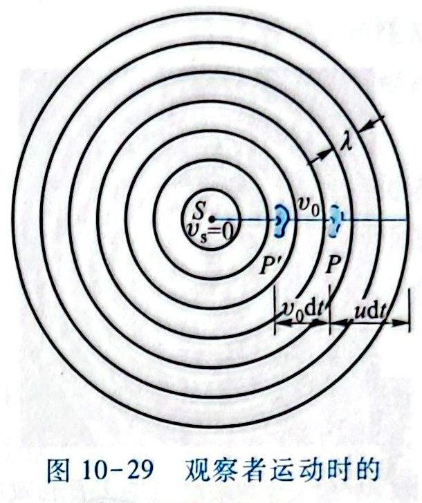

图10-29 观察者运动时的多普勒效应

$$
\nu^ {\prime} = \frac {u + v _ {0}}{u} \nu\tag{10-22}
$$

这表明,当观察者向着静止波源运动时,观察者接收到的频率为波源频率的 $(1+v_{0}/u)$ 倍,即 $\nu'$ 高于 $\nu$ .

当观察者远离静止波源运动时,通过类似的分析,不难求得观察者接收到的频率为

$$
\nu^ {\prime} = \frac {u - v _ {0}}{u} \nu\tag{10-23}
$$

即此时接收到的频率低于波源的频率.

### 二、观察者不动,波源相对介质以速度 $v_{s}$ 运动

当波源运动时,介质中的波长将发生变化.图10-30是波源在水中向右运动时所激起的水面波的照片.它显示出沿着波源运动的方向,波长变短了;而背离波源运动的方向,波长变长了.大家知道,波长是介质中相位差为 $2\pi$ 的两个振动状态之间的距离,而由于波源是运动的,它所发出的这两个相位差为 $2\pi$ 的振动状态,是在不同的地点发出的.如图10-31所示,假设波源以速度 $v_{s}$ 向着观察者运动,则当波源从 $S

### 本页手写批注

- 本页印刷正文已按扫描转录。手写主要是下划线或页边短注；除能确认的记号外，不把潦草笔迹猜成公式。

## 扫描第 18 页

> 扫描页码：18 / 45。书中印刷页码见页眉（本页 OCR 未单独认出阿拉伯页码）；页眉含章名；可见节号 10-3；页眉摘录：第十章波动 波源已运动到了S（S,S=v.T），此时才发出与该振动状态相位差为2π的 个振动状态。

波源已运动到了 $S_{2}(S_{1}S_{2} = v_{\mathrm{s}}T)$ ，此时才发出与该振动状态相位差为 $2\pi$ 的下一个振动状态，可见 $S_{2}$ 与 $A$ 之间的距离即为此情形下介质中的波长 $\lambda_{\mathrm{b}}$ .若波源静止时的波长为 $\lambda (= uT)$ ，则从图10-31中可见，此时介质中的波长为

$$
\lambda_ {\mathrm{b}} = \lambda - v _ {\mathrm{s}} T = (u - v _ {\mathrm{s}}) T = \frac {u - v _ {\mathrm{s}}}{\nu}
$$

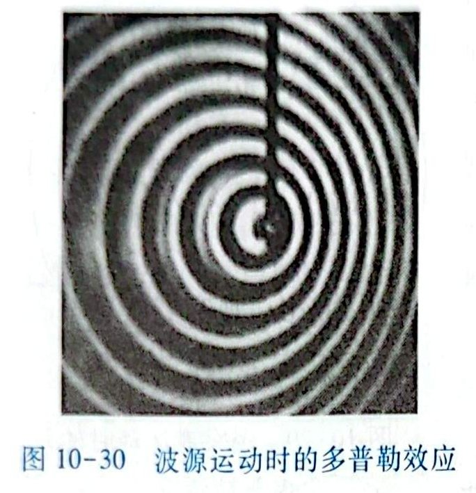

图10-30 波源运动时的多普勒效应；图10-31 波源运动的前方波长变短

或者说,此时波的频率为

$$
\nu_ {\mathrm{b}} = \frac {u}{\lambda_ {\mathrm{b}}} = \frac {u}{u - v _ {\mathrm{s}}} \nu
$$

由于观察者静止,因此他接收到的频率就是波的频率,即 $\nu'=\nu_{b}$ . 观察者接收到的频率为

$$
\nu^ {\prime} = \frac {u}{u - v _ {\mathrm{s}}} \nu\tag{10-24}
$$

这表明,当波源向着静止的观察者运动时,观察者接收到的频率高于波源的频率.

当波源远离静止的观察者运动时,通过类似的分析,可求得观察者接收到的频率为

$$
\nu^ {\prime} = \frac {u}{u + v _ {\mathrm{s}}} \nu\tag{10-25}
$$

即此时接收到的频率低于波源的频率.

### 三、波源与观察者同时相对介质运动

综合以上两种情况可得,当波源与观察者同时相对介质运动时,观察者所

### 本页手写批注

- 本页印刷正文已按扫描转录。手写主要是下划线或页边短注；除能确认的记号外，不把潦草笔迹猜成公式。

## 扫描第 19 页

> 扫描页码：19 / 45。书中印刷页码约 73；可见节号 10-6；页眉摘录：10-6多普勒效应 73 utvo u干v， (10-26) 上式中，观察者向着波源运动时,前取。

$$
\nu^ {\prime} = \frac {u \pm v _ {0}}{u \mp v _ {\mathrm{s}}} \nu\tag{10-26}
$$

上式中, 观察者向着波源运动时, $v_{0}$ 前取正号, 远离时取负号; 波源向着观察者运动时, $v_{\mathrm{s}}$ 前取负号, 远离时取正号.

综上可知,不论是波源运动,还是观察者运动,或是两者同时运动,定性地说:只要两者互相接近,接收到的频率就高于原来波源的频率;只要两者互相远离,接收到的频率就低于原来波源的频率.

最后,可以指出,即使波源与观察者并非沿着它们的连线运动,以上所得各式仍可适用,只是其中 $v_{\mathrm{s}}$ 和 $v_{0}$ 应作为运动速度沿连线方向的分量就行了,而垂直于连线方向的分量是不产生多普勒效应的(在本节的例3中将会看到对这种情况是如何处理的).

不仅机械波有多普勒效应,电磁波也有多普勒效应.由于电磁波传播的速度为光速,因此要运用相对论来处理这个问题,且观察者接收频率的公式将与式(10-26)有所不同.然而波源与观察者互相接近时,频率变大,互相远离时,频率变小的结论,仍然是相同的.后面第14-6节对此有详细的讨论分析.

多普勒效应有着很多实际的应用,可参阅有关书籍 $^{①}$ .

**例1**

图 10-32 中 A、B 为两个汽笛, 其频率均为 $500 \mathrm{~Hz}$, A 是静止的, 而 B 以 $60 \mathrm{~m} \cdot \mathrm{s}^{-1}$ 的速率向右运动. 在两个汽笛之间, 一观察者 O 以 $30 \mathrm{~m} \cdot \mathrm{s}^{-1}$ 的速度也向右运动. 已知空气中的声速为 $330 \mathrm{~m} \cdot \mathrm{s}^{-1}$, 求:

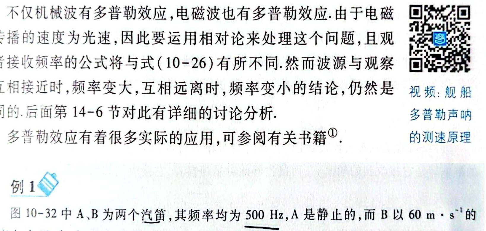

图10-32

（1）观察者听到来自A的频率；

(2) 观察者听到来自 B 的频率；

(3) 观察者听到的拍频.

解 在式(10-26) $\nu^{\prime} = \frac{u\pm v_{0}}{u\mp v_{s}}\nu$ 中, 已知 $u = 330 \mathrm{~m} \cdot \mathrm{s}^{-1}, v_{\mathrm{sA}} = 0, v_{\mathrm{sB}} = 60 \mathrm{~m} \cdot \mathrm{s}^{-1}, v_{0} = 30 \mathrm{~m} \cdot \mathrm{s}^{-1}, \nu = 500 \mathrm{~Hz}$.

> 注：① 例如可参阅马文蔚等主编《物理学原理在工程技术中的应用》(第四版

### 本页手写批注

- 本页印刷正文已按扫描转录。手写主要是下划线或页边短注；除能确认的记号外，不把潦草笔迹猜成公式。

## 扫描第 20 页

> 扫描页码：20 / 45。书中印刷页码约 97；可见节号 11-1；页眉摘录：11-1 相干光 97 200年，才分别由傅科（J.B.L.Foucault，1819-1868。

200年,才分别由傅科(J.B.L.Foucault,1819—1868)和菲佐(A.H.L.Fizeau, 1819—1896)解决,他们各用自己的实验测出了光在水中的速度比在空气中要小.至此,支持光的微粒说的人就很少了,光的波动说取得了决定性的胜利. 在19世纪的中期,麦克斯韦和赫兹等找到了光和电磁波之间的联系,奠定了光的电磁理论的基础.

到了19世纪末期和20世纪初期,人们通过对黑体辐射、光电效应和康普顿效应的研究,又无可怀疑地证实了光的量子性,形成了一种具有崭新内涵的微粒学说.面对这两种各有坚实实验基础的波动说和微粒说,人们对光的本性的认识又向前迈进了一大步,即承认光具有波粒二象性①.因为光具有波粒二象性,所以对光的全面描述需运用量子力学的理论.根据光的量子性,从微观过程上研究光与物质相互作用的学科叫做量子光学.

20 世纪 60 年代激光的发现使光学的发展又获得了新的活力。激光技术与相关学科相结合,导致了光全息技术、光信息处理技术、光纤技术等的飞速发展,特别是光纤的发展为光通信等创造了条件。非线性光学、傅里叶光学等现代光学分支也逐渐形成,从而带动了物理学及其相关学科的不断发展。

本章介绍光学,包括波动光学的基本内容和几何光学简介.波动光学是根据光的波动性研究光的传播规律的光学分支,主要内容有:光的干涉、衍射及其应用,X射线的衍射,光的偏振现象和偏振光的干涉及其应用等.本章最后一节是对几何光学基本现象的介绍.

## 11-1 相 干 光

干涉现象是波动过程的基本特征之一.第十章已经指出:由频率相同、振动方向相同、相位相同或相位差恒定的两个波源所发出的波是相干波,在两相干波相遇的区域内,有些点的振动始终加强,有些点的振动始终减弱或完全抵消,即产生干涉现象.

对于光波来说,振动的物理量是电场强度 E 和磁场强度 H,其中能引起人眼视觉或底片感光的是 E,故通常把 E 矢量称为光矢量.若两束光的光矢量满足相干条件,则它们是相干光,相应的光源称为相干光源.

> 注：① 参见本书第十五章第15-2节

### 本页手写批注

- 本页印刷正文已按扫描转录。手写主要是下划线或页边短注；除能确认的记号外，不把潦草笔迹猜成公式。

## 扫描第 21 页

> 扫描页码：21 / 45。书中印刷页码约 100；页眉含章名；页眉摘录：100 第十一章光学 是激光束干涉实验的示意图，图中通过 A、B两个狭缝的激光是相干光, 互干涉。

是激光束干涉实验的示意图,图中通过 A、B 两个狭缝的激光是相干光,它们相互干涉,在远处屏幕 P 上产生明暗相间的干涉条纹.

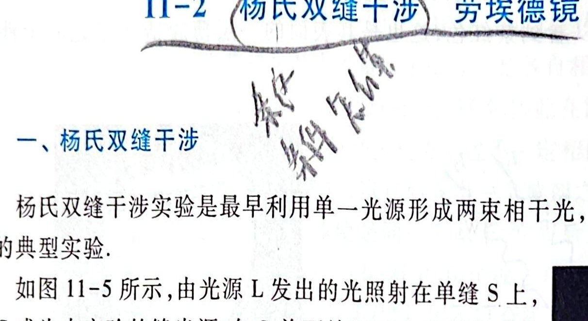

图11-4 激光束干涉实验

> 注：① 详细讨论请参见本章第11-3节.

> 注：② 关于激光的相干性参见本书第十五章.

除了振幅分割法以外,还有一种用分光束获得相干光的方法,称为波阵面分割法,就是在光源发出的某一波阵面上,取出两部分面元作为相干光源的方法.下面将要介绍的杨氏双缝和劳埃德镜等光的干涉实验,都是用波阵面分割法实现的.

## 11-2 杨氏双缝干涉 劳埃德镜

### 一、杨氏双缝干涉

杨氏双缝干涉实验是最早利用单一光源形成两束相干光,从而获得干涉现象的典型实验.

如图 11-5 所示,由光源 L 发出的光照射在单缝 S 上,使 S 成为本实验的缝光源.在 S 前面放置两个相距很近的狭缝 $S_{1}$ 和 $S_{2}$,且 $S_{1}, S_{2}$ 与 S 之间的距离均相等.$S_{1}, S_{2}$ 是由同一光源 S 形成的,满足振动方向相同、频率相同、相位差恒定 (而图 11-5(a) 中的相位差为零) 的相干条件,故 $S_{1}, S_{2}$ 为相干光源.这样,由 $S_{1}$ 和 $S_{2}$ 发出的光在空间相遇,将产生干涉现象.若在 $S_{1}$ 和 $S_{2}$ 的前面放一屏幕 P ,则屏幕上将出现明、暗交替的干涉条纹 [图 11-5(b)].

> [插图：(a) 双缝干涉；图11-5 杨氏双缝干涉实验

本页另有从扫描件裁出的图：
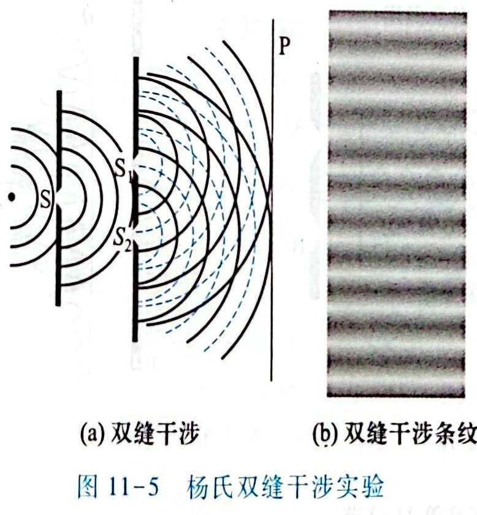

图11-5杨氏双缝干涉实验

### 本页手写批注

- 本页印刷正文已按扫描转录。手写主要是下划线或页边短注；除能确认的记号外，不把潦草笔迹猜成公式。

## 扫描第 22 页

> 扫描页码：22 / 45。书中印刷页码约 101；可见节号 11-2；页眉摘录：11-2杨氏双缝干涉劳埃德镜 101 下面定量分析屏幕上形成干涉明、暗条纹所应满足的条件.如图1。

下面定量分析屏幕上形成干涉明、暗条纹所应满足的条件.如图11-6所示,设 $S_{1}$ 和 $S_{2}$ 间的距离为d,双缝所在平面与屏幕P平行,两者之间的垂直距离为 $d'$ .今在屏幕上任取一点B,它与 $S_{1}$ 和 $S_{2}$ 的距离分别为 $r_{1}$ 和 $r_{2}$ ,若 $O_{1}$ 为 $S_{1}$ 和 $S_{2}$ 的中点,O与 $O_{1}$ 正对,点B与点O的距离为x.为能获得明显的干涉条纹,在通常情况下,d很小,而双缝到屏幕间的垂直距离远大于双缝间的距离,即 $d'\gg d$ .这时,由 $S_{1}$ 、 $S_{2}$ 发出的光到达屏上点B的波程差 $\Delta r$ 为

$$
\Delta r = r _ {2} - r _ {1} \approx d \sin \theta
$$

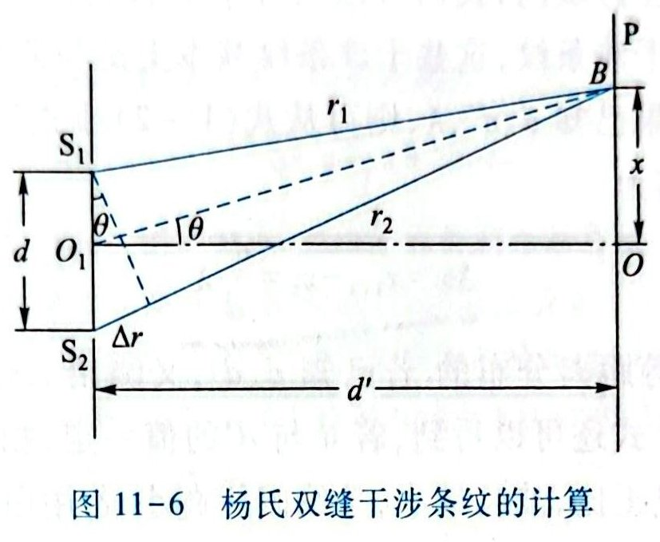

图11-6 杨氏双缝干涉条纹的计算

若 $\Delta r$ 满足条件

$$
d \sin \theta = \pm k \lambda , \quad k = 0, 1, 2, \dots\tag{11-1}
$$

则点 B 处为一明条纹的中心.式中正负号表明干涉条纹在点 O 两边是对称分布的.对于点 $O, \theta = 0, \Delta r = 0, k = 0$ ; 因此, 点 O 处也为一明条纹的中心, 此明条纹叫做中央明纹. 在点 O 两侧, 与 $k = 1, 2, \cdots$ 相应的 $x_{k}$ 处, $\Delta r$ 分别为 $\pm \lambda, \pm 2\lambda, \cdots$ , 这些明条纹分别叫第一级、第二级……明条纹. 它们对称地分布在中央明纹的两侧.

因为 $d' \gg d$, 所以 $\sin \theta \approx \tan \theta = x / d'$. 于是, 式 (11-1) 的干涉加强条件可改写为

$$
d \frac {x}{d ^ {\prime}} = \pm k \lambda , \quad k = 0, 1, 2, \dots
$$

即在屏上

$$
x = \pm \frac {d ^ {\prime}}{d} k \lambda , \quad k = 0, 1, 2, \dots\tag{11-2}
$$

的各处,都是明条纹的中心.当点 B 处满足

### 本页手写批注

- 本页印刷正文已按扫描转录。手写主要是下划线或页边短注；除能确认的记号外，不把潦草笔迹猜成公式。

## 扫描第 23 页

> 扫描页码：23 / 45。书中印刷页码约 102；页眉含章名；页眉摘录：102 第十一章光学 即 d' Y x=± (2k+1) k=0,1,2,... 时,两束光干涉。

$$
x = \pm \frac {d ^ {\prime}}{d} (2 k + 1) \frac {\lambda}{2}, \quad k = 0, 1, 2, \dots\tag{11-3}
$$

11-2),也不满足式(11-3),则点B处既不是最明,也不是最暗.一般而言,可认为两个相邻暗条纹中心之间的距离为一个明条纹的宽度.

综上所述,在干涉区域内,我们可以从屏幕上看到,在中央明纹两侧对称地分布着明、暗相间的干涉条纹,这些干涉条纹基本上是与缝形状相同的一条条直线[图11-5(b)].如果已知 $d 、 d^{\prime} 、 \lambda$, 则可从式(11-2)或式(11-3)算出相邻明纹或暗纹中心间的距离为

$$
\Delta x = x _ {k + 1} - x _ {k} = \frac {d ^ {\prime}}{d} \lambda
$$

即干涉明、暗条纹是等距离分布的.若已知 $d, d'$, 又测出 $\Delta x$, 则由上式可以算出单色光的波长 $\lambda$. 由上式还可以看到, 若 $d$ 与 $d'$ 的值一定, 相邻条纹间的距离 $\Delta x$ 与入射光的波长 $\lambda$ 成正比, 波长越小, 条纹间距越小. 若用白光照射, 由于不同波长的光出现干涉极大的位置相互错开 (中央明纹除外), 则在中央明纹 (白色) 的两侧将出现彩色条纹并形成连续的光谱. 图 11-7 画出了蓝、红两种颜色的光形成的干涉图样, 图中 $\Delta x_{1}, \Delta x_{2}$ 分别表示蓝光和红光的明纹间距.

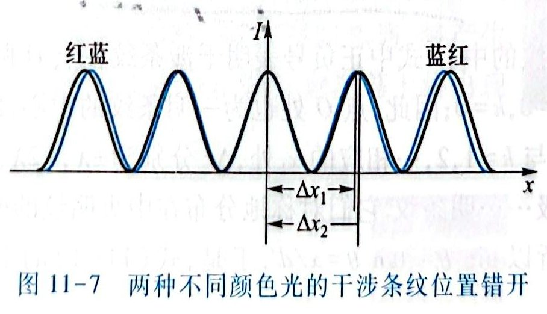

图11-7 两种不同颜色光的干涉条纹位置错开

单色光照射到相距为 $0.2 \, mm$ 的双缝上, 双缝与屏幕的垂直距离为 $10 \, m$ .

(1) 若屏上第一级干涉明纹到同侧的第四级明纹中心间的距离为 $75 \mathrm{~mm}$, 求单色光的波长;

(2) 若入射光的波长为 $600 \, nm$ ，求相邻两暗纹中心间的距离.

解（1）根据双缝干涉明纹的条件，第 $k$ 级明纹中心的坐标为

本页另有从扫描件裁出的图：

### 本页手写批注

- 本页印刷正文已按扫描转录。手写主要是下划线或页边短注；除能确认的记号外，不把潦草笔迹猜成公式。

## 扫描第 24 页

> 扫描页码：24 / 45。书中印刷页码约 103；可见节号 11-2；页眉摘录：11-2杨氏双缝干涉劳埃德镜 103 k=0,1,2,... =1和k=4代人上式得，第一级与第。

在上面的例子中,双缝间的距离很小,这样才能看到干涉条纹.而屏幕距离双缝很远,这时运用式(11-2)等计算比较准确.一般来说,当屏幕与双缝间的距离达到10 m时,式(11-2)、(11-3)所用到的近似条件才不影响计算结果的准确性.这一点值得读者注意.

从上面的例子还可以看到,利用双缝干涉可以测量光的波长.不过,这种测量精度不够高,上面提到的近似条件就是一个原因.

### \*二、杨氏双缝干涉的光强分布

设图 11-6 中狭缝 $S_{1}$ 、 $S_{2}$ 发出的光波单独到达屏上任一点 B 处的振幅分别为 $A_{1}$ 、 $A_{2}$ ，光强分别为 $I_{1}$ 、 $I_{2}$ ，则根据式(9-23)，两光波叠加后的振幅为

$$
A = \sqrt {A _ {1} ^ {2} + A _ {2} ^ {2} + 2 A _ {1} A _ {2} \cos (\varphi_ {2} - \varphi_ {1})}\tag{11-4a}
$$

式中 $\varphi_{2} - \varphi_{1} = 2\pi \frac{\Delta r}{\lambda}$. 而叠加后的光强为

$$
I = I _ {1} + I _ {2} + 2 \sqrt {I _ {1} I _ {2}} \cos (\varphi_ {2} - \varphi_ {1})\tag{11-4b}
$$

假定 $A_{1} = A_{2} = A_{0}$ ，则 $I_{1} = I_{2} = I_{0}$ ，于是，式(11-4b)可化简成

$$
I = 4 I _ {0} \cos^ {2} \left(\pi \frac {\Delta r}{\lambda}\right)\tag{11-4c}
$$

由此可知， $\Delta r=\pm k\lambda(k=0,1,2,\cdots)$ 的地方，光强 $I=4I_{0}$ ，是明条纹的最亮处；而对应于 $\Delta r=\pm(2k+1)\frac{\lambda}{2}(k=0,1,2,\cdots)$ 的各处，光强I=0，是暗条纹的最暗处（图11-8）。容易明白，从能量的观点看,干涉使光的能量重新进行了分布,而光的总能量仍是守恒的.

由式(11-4b)可知,叠加后的光强

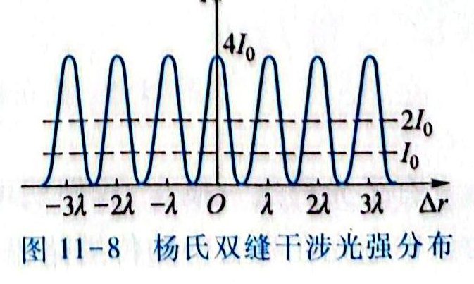

图11-8 杨氏双缝干涉光强分布

本页另有从扫描件裁出的图：
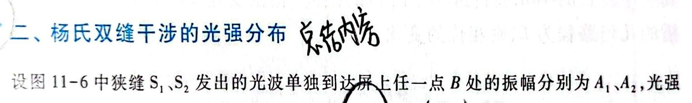

设图11-6中狭缝S,、S2发出的光波单独到达屏上任一点B处的振幅分别为AA2,光强

### 本页手写批注

- 本页印刷正文已按扫描转录。手写主要是下划线或页边短注；除能确认的记号外，不把潦草笔迹猜成公式。

## 扫描第 25 页

> 扫描页码：25 / 45。书中印刷页码约 104；页眉含章名；可见节号 11-8；页眉摘录：104 第十一章光学 光源S,S。相干,所以△对各点是确定的，两光的叠加是相干叠加，光强I呈现如。

由式 (11-4b) 可知, 这时观察到的光强 $I = I_{1} + I_{2}$, 这就是非相干叠加的情形.

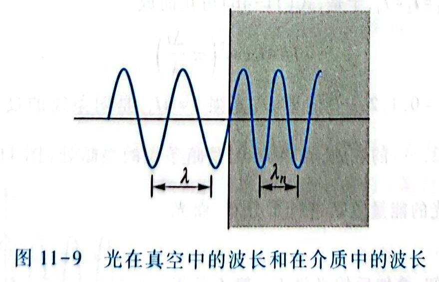

图11-8 杨氏双缝干涉光强分布

上述讨论对于类似双缝干涉的其他干涉光强分布也适用。

### 三、光程和光程差

以上所讨论的杨氏双缝干涉,两束相干光是在同一种介质(如空气)中传播的,所以只要计算出两相干光到达相遇点时的几何路程差,即波程差 $\Delta r$ , 就可根据波程差与相位差的关系式 $\Delta\varphi=\frac{2\pi}{\lambda}\Delta r$ 确定两相干光的相位差 $\Delta\varphi$ . 但当两束光分别通过不同介质时,由于同一频率的光在不同介质中的传播速度不同,因此不同介质中的光波波长不同,这时就不能只根据几何路程差来计算相位差了.为此,我们引入光程这一概念.

设有一频率为 $\nu$ 的单色光, 它在真空中的波长为 $\lambda$, 传播速度为 $c$. 当它在折射率为 $n$ 的介质中传播时, 传播速度变为 $v = c / n$, 所以波长 $\lambda_{n} = v / \nu = c / (n\nu) = \lambda / n$ (图11-9). 这说明, 一定频率的光在折射率为 $n$ 的介质中传播时, 其波长为真空中波长的 $1 / n$. 波行进一个波长的距离, 相位变化 $2 \pi$, 若光波在该介质中传播的几何路程为 $L$, 则相位的变化为

$$
\Delta \varphi = 2 \pi \frac {L}{\lambda_ {n}} = 2 \pi \frac {n L}{\lambda}\tag{11-5}
$$

上式表明,光波在介质中传播时,其相位的变化不仅与光波传播的几何路程和真空中的波长有关,而且还与介质的折射率有关.光在折射率为 n 的介质中通过几何路程 L 所发生的相位变化,相当于光在真空中通过 nL 的路程所发生的相位变化.所以,人们把折射率 n 和几何路程 L 的乘积 nL,叫做光程.

> [插图：图11-9 光在真空中的波长和在介质中的波长]

有了光程这一概念,我们就可以把单色光在不同介质中的传播路程,都折算为该单色光在真空中的传播路程.由此可见,两相干光分别通过不同的介质在空

本页另有从扫描件裁出的图：
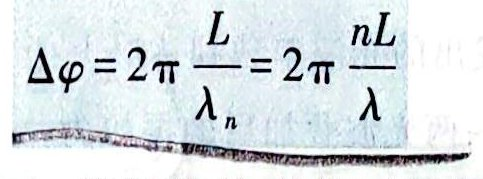

### 本页手写批注

- 本页印刷正文已按扫描转录。手写主要是下划线或页边短注；除能确认的记号外，不把潦草笔迹猜成公式。

## 扫描第 26 页

> 扫描页码：26 / 45。书中印刷页码见页眉（本页 OCR 未单独认出阿拉伯页码）；页眉含章名；页眉摘录：第十二章 气体动理论 物质的运动形式是多种多样的.在力学中已经研究了物质最简单的运动 形式一——。

第十二章 气体动理论

物质的运动形式是多种多样的。在力学中已经研究了物质最简单的运动形式——机械运动，并采用了牛顿力学的确定论的研究方法。在这一章和下一章中，将研究物质的热运动。而研究热运动的规律有宏观的热力学和微观的统计力学两种方法。统计力学方法是从宏观物体由大量微观粒子（原子、分子等）所构成、粒子又不停地作热运动的观点出发，运用概率论和统计方法研究大量微观粒子的热运动规律，这一章气体动理论将讨论这方面的问题。热力学方法，是从能量观点出发，以大量实验观测为基础，来研究物质热现象的宏观基本规律及其应用，这将在下一章讨论。热力学和气体动理论是从不同的角度研究物质热运动规律的，它们是相辅相成的。

本章的主要内容有:平衡态,热力学第零定律,物质的微观模型,理想气体的压强和温度的微观本质,能量均分定理,理想气体的内能,以及分子的速率分布定律,分子平均自由程和平均碰撞频率等.

## 12-1 平衡态 理想气体物态方程 热力学第零定律

### 一、气体的物态参量

在力学中研究质点的机械运动时,我们用位矢和速度(动量)来描述质点的运动状态.而在讨论由大量作热运动的分子构成的气体状态时,位矢和速度(动量)只能用来描述分子的微观状态.为了研究整个气体的宏观状态,对一定量的气体,可用气体的体积 V、压强 p 和热力学温度 $T^{①}$ 来描述.气体的体积、压强和温度这三个物理量叫做气体的物态参量,其中体积 V 是几何量,压强 p 是力学量,而温度 T 属热学量.它们都是宏观量.而组成气体的分子都具有各自的质量、速度,动量、能量等,这些描述个别分子的物理量称为微观量.

> 注：① 在一般讲述时,常将热力学温度简称为温度

### 本页手写批注

- 本页印刷正文已按扫描转录。手写主要是下划线或页边短注；除能确认的记号外，不把潦草笔迹猜成公式。

## 扫描第 27 页

> 扫描页码：27 / 45。书中印刷页码约 186；页眉含章名；页眉摘录：186 第十二章气体动理论 子都具有各自的质量、速度,动量、能量等,这些描述个别分子的物理量称为。

子都具有各自的质量、速度,动量、能量等,这些描述个别分子的物理量称为微观量.

> 注：① 在一般讲述时,常将热力学温度简称为温度.

气体的体积是指气体所能达到的空间.在国际单位制中,体积的单位名称是立方米,符号是 ${\mathrm{m}}^{3}$ .体积单位有时也用立方分米,即升(liter),符号是L.1 L= $1\mathrm{\;{dm}}{}^{3} = {10}^{-3}{\mathrm{\;m}}^{3}$ .

气体的压强是作用于单位面积的正压力,即 $p = F / S$. 在国际单位制中,压强的单位名称是帕斯卡①,符号是 $\mathrm{Pa}.1\mathrm{Pa} = 1\mathrm{N}\cdot \mathrm{m}^{-2}$. 通常,人们把 $45^{\circ}$ 纬度海平面处测得 $0^{\circ}\mathrm{C}$ 时大气压的值 $(1.013\times 10^{5}\mathrm{Pa})$ 称为标准大气压.温度是物体冷热程度的数值表示.温度的数值标定方法叫做温标.根据1987年第18届国际计量大会对国际实用温标的决议,热力学温标为最基本的温标②,一切温度的测量最终都应以热力学温标为准.在国际单位制中,热力学温度是7个基本量之一.热力学温度的符号为 $T$,它的单位名称是开尔文(kelvin)③,符号是K.

在工程上和日常生活中, 目前常使用摄尔修斯④温标, 简称摄氏温标. 在摄氏温标中, 温度的符号为 $t$, 单位符号是 $\mathrm{^\circ C}$. 摄氏温度与热力学温度之间的关系为

$$
t / ℃ = T / K - 273.15 \quad \text {或} \quad T / K = 273.15 + t / ℃
$$

### 二、平衡态

把一定质量的气体装在一给定体积的容器中,经过一段较长时间后,容器中各部分气体的压强 p 相等、温度 T 相同.此时气体的物态参量都具有确定的值.如果容器中的气体与外界之间没有能量和物质的传递,气体的能量也没有转化为其他形式的能量,气体的组成及其质量均不随时间变化,则气体的物态参量将不随时间而变化,这样的状态叫做平衡态.不过,应当指出,容器中的气体总不可避免地会与外界发生不同程度的能量和物质的传递,理想化了的平衡状态是难

> 注：① 帕斯卡(B.Pascal,1623—1662)，法国数学家和物理学家、物理学方面的成就主要是流体静力学。他提出大气压力随高度的增加而减小的想法，不久得到证实。参见本章第12-7节气压公式。为纪念他，国际单位制中压强的单位用“帕斯卡”命名。

> 注：② 如有兴趣了解热力学温标的建立,可参阅张玉民、阮耀钟编《热学》之31—40页(高等教育出版社,1991年).

> 注：③ 开尔文原名汤姆孙(W.Thomson,1824—1907),英国物理学家,热力学的奠基人之一.1851年表述了热力学第二定律(参见本章第12-6节).他在热力学、电磁学、波动和涡流等方面卓有贡献,1892年被授予开尔文爵士称号.他在1848年引入并在1854年修改的温标称为开尔文温标.为纪念他,国际单位制中温度的单位用“开尔文”命名,其最新定义参见本书上册附录二.

> 注：④ 摄尔修斯(A.Celsius,1701—1744),瑞典天文学家和物理学家.1742年他提出百度温标,将正常大气压下水的沸点和冰的熔点之间分为100度

本页另有从扫描件裁出的图：

### 本页手写批注

- 本页印刷正文已按扫描转录。手写主要是下划线或页边短注；除能确认的记号外，不把潦草笔迹猜成公式。

## 扫描第 28 页

> 扫描页码：28 / 45。书中印刷页码约 187；可见节号 12-1；页眉摘录：12-1平衡态理想气休物态方程热力学第零定律 187 免地会与外界发生不同程度的能量和物质的传递。

免地会与外界发生不同程度的能量和物质的传递,理想化了的平衡状态是难

> 注：① 帕斯卡(B.Pascal,1623—1662)，法国数学家和物理学家、物理学方面的成就主要是流体静力学。他提出大气压力随高度的增加而减小的想法，不久得到证实。参见本章第12-7节气压公式。为纪念他，国际单位制中压强的单位用“帕斯卡”命名。

> 注：② 如有兴趣了解热力学温标的建立,可参阅张玉民、阮耀钟编《热学》之31—40页(高等教育出版社,1991年).

> 注：③ 开尔文原名汤姆孙(W.Thomson,1824—1907),英国物理学家,热力学的奠基人之一.1851年表述了热力学第二定律(参见本章第12-6节).他在热力学、电磁学、波动和涡流等方面卓有贡献,1892年被授予开尔文爵士称号.他在1848年引入并在1854年修改的温标称为开尔文温标.为纪念他,国际单位制中温度的单位用“开尔文”命名,其最新定义参见本书上册附录二.

> 注：④ 摄尔修斯(A.Celsius,1701—1744),瑞典天文学家和物理学家.1742年他提出百度温标,将正常大气压下水的沸点和冰的熔点之间分为100度.

以存在的.然而,若气体状态的变化很微小,以致可以略去不计时,则可以把气体的状态看成近似平衡态.本章所讨论的气体状态,除特别声明外,指的都是平衡态.

处在平衡态的气体状态可以用一组 $p, V, T$ 值来表示, 也可以 $p$ 为纵轴、$V$ 为横轴的 $p - V$ 图上一个确定的点来表示, 如图12-1中的点 $A(p_1, V_1, T_1)$ 或点 $B(p_2, V_2, T_2)$ 所示.

### 三、理想气体物态方程

> [插图：图12-1 $p - V$ 图上一点代表气体的一个平衡态]

对处于平衡态的一定量气体来说,当其物态参量中任意一个参量发生变化时,其他两个参量一般也将随之改变.但这三个物态参量也必有一定的关系,即其中一个量是其他两个量的函数,如

$$
T = f (p, V)
$$

这个方程就是一定量的气体处于平衡态时的气体物态方程.一般来说,这个方程的形式是很复杂的,它与气体的性质有关.这里我们只讨论理想气体的物态方程,第12-10节再讨论实际气体的物态方程.

我们知道,任何一个物理定律都有一定的适用范围.一定量的气体,在温度不太低(与室温相比)、压强不太大(与大气压强相比)的实验条件下可总结出三条实验定律①.设想有这样一种气体,它在任何情况下都遵守上述三条实验定律和阿伏伽德罗定律②,这种气体叫做理想气体.故理想气体也是一种理想模型.如上所述,一般气体在温度不太低、压强不太大时,都可近似当作理想气体.因此,研究理想气体各物态参量之间的关系即理想气体物态方程,仍有重要意义.

由气体的三个实验定律和阿伏伽德罗定律可得,平衡态时理想气体的物态方程为

$$
p V = N k T\tag{12-1a}
$$

> 注：① 玻意耳(Boyle)定律: 当 $T =$ 常量时, $pV = C_1$; 盖吕萨克(Gay-Lussac)定律: 当 $p =$ 常量时, $V / T = C_2$; 查理(Charles)定律: 当 $V =$ 常量时, $p / T = C_3$.

> 注：② 阿伏伽德罗(A.Avogadro,1776—1856),意大利物理学家.他在1811年提出,在同样的温度和压强下,相同体积的气体含有相同数量的分子.这就是阿伏伽德罗定律

本页另有从扫描件裁出的图：

### 本页手写批注

- 本页印刷正文已按扫描转录。手写主要是下划线或页边短注；除能确认的记号外，不把潦草笔迹猜成公式。

## 扫描第 29 页

> 扫描页码：29 / 45。书中印刷页码约 188；页眉含章名；可见节号 10-2；页眉摘录：188 第十二章气体动理论 式中N是体积V中的气体分子数，k称为玻耳兹曼常量，一般计算时，取 k。

$$
p V = N k T\tag{12-1a}
$$

> 注：① 玻意耳(Boyle)定律: 当 $T =$ 常量时, $pV = C_1$; 盖吕萨克(Gay-Lussac)定律: 当 $p =$ 常量时, $V / T = C_2$; 查理(Charles)定律: 当 $V =$ 常量时, $p / T = C_3$.

> 注：② 阿伏伽德罗(A.Avogadro,1776—1856),意大利物理学家.他在1811年提出,在同样的温度和压强下,相同体积的气体含有相同数量的分子.这就是阿伏伽德罗定律.

式中 N 是体积 V 中的气体分子数, k 称为玻耳兹曼常量, 一般计算时, 取

$$
k = 1.38 \times 10 ^ {- 23} \mathrm{J} \cdot \mathrm{K} ^ {- 1}
$$

理想气体的物态方程还可以写成其他形式.大家知道，任何一种物质每1 mol所含的分子数叫做阿伏伽德罗常量，用符号 $N_{A}$ 表示，一般计算时，取

$$
N _ {\mathrm{A}} = 6.02 \times 10 ^ {23} \mathrm{mol} ^ {- 1} ①
$$

我们把 N 与 $N_{A}$ 的比值 $N/N_{A}$ 叫做物质的量 $\nu$ ，即 $\nu=N/N_{A}$ 。这样式(12-1a)可写成

$$
p V = \nu N _ {\mathrm{A}} k T
$$

$$
p V = \nu R T\tag{12-1b}
$$

如果每个分子的质量为 $m$, 气体的质量为 $m'$, 该气体的摩尔质量为 $M$, 那么, 物质的量 $\nu = N / N_{\mathrm{A}} = mN / mN_{\mathrm{A}} = m' / M$. 于是, 理想气体物态方程亦可写成

$$
p V = \frac {m ^ {\prime}}{M} R T\tag{12-1c}
$$

如将 N/V=n 叫做气体的分子数密度,由式(12-1a)还可得到

$$
p = n k T\tag{12-1d}
$$

### 四、热力学第零定律

人们从经验和科学实验中知道,在没有做功的情况下,如果两个物体在相互接触的过程中,有能量从一个物体传递给另一个物体,那么我们就说这两个物体之间有温差.在两个物体之间停止了能量传递后,它们就达到了热平衡.

如图 12-2(a) 所示, A、B 两个物体放在绝热板上, 物体间被绝热壁所隔开. 用一个测温计 C 先与物体 A 相接触, 达到热平衡后, 测温计 C 上有一个读数; 再将测温计 C 与物体 B 相接触, 达到热平衡后, 测温计 C 上也有一个读数. 若这两个读数相等, 我们认为 A、B 两物体彼此间也达到了热平衡. 所以, 如使 A、B 两物体按图 12-2(b) 所示相接触, 它们之间也不会有能量传递.

> 注：① 国际科学联合会理事会科学技术数据委员会2014年对基本常量 $N_{\mathrm{A}}$ 的推荐值为6.022140857(74) $\times 10^{23}\mathrm{mol}^{-1}$, 2018年11月16日, 第26届国际计量大会修订 $N_{\mathrm{A}}$ 为精确值6.022140 $76\times 10^{23}\mathrm{mol}^{-1}$.

> 注：② 这是国际科学联合会理事会科学技术数据委员会2018年的推荐值(温度为 $273.15\mathrm{K}$, 压强为 $1.01325 \times 10

本页另有从扫描件裁出的图：
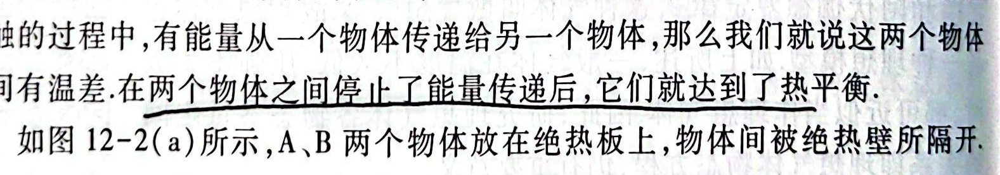

如图12-2(a)所示,A、B 两个物体放在绝热板上,物体间被绝热壁所隔开.
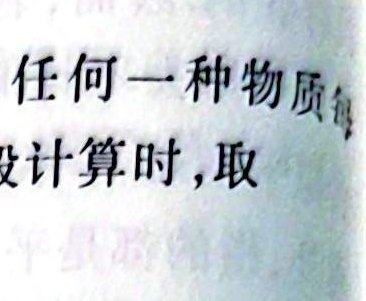
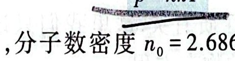

### 本页手写批注

- 本页印刷正文已按扫描转录。手写主要是下划线或页边短注；除能确认的记号外，不把潦草笔迹猜成公式。

## 扫描第 30 页

> 扫描页码：30 / 45。书中印刷页码约 195；可见节号 12-4；页眉摘录：12-4理想气体分子的平均平动动能与温度的关系 195 把它代人式（12-2），并设n=- 一为。

文档：压强公式的其他推导方法（原页二维码，未访问链接）

把它代入式(12-2)，并设 $n = \frac{N}{xyz}$ 为单位体积内的分子数，即分子数密度，得

$$
p = \frac {1}{3} n m \overline {{v ^ {2}}}\tag{12-3a}
$$

或

$$
p = \frac {2}{3} n \left(\frac {1}{2} m \overline {{v ^ {2}}}\right)\tag{12-3b}
$$

$$
p = \frac {2}{3} n \varepsilon_ {\mathrm{k}}\tag{12-3c}
$$

上式叫做理想气体的压强公式.由式(12-3c)可见,气体作用于器壁的压强正比于分子的数密度n和分子的平均平动动能 $\bar{\varepsilon}_{k}$ .分子的数密度越大,压强越大;分子平均平动动能越大,压强也越大.实际上,分子对器壁的碰撞是不连续的,器壁所受到的冲量的数值是起伏不定的,只有在气体的分子数足够大时,器壁所获得的冲量才有确定的统计平均值.若说个别分子产生多大压强,这是无意义的,压强是一个统计量.应当指出,压强虽说是由大量分子对器壁碰撞而产生的,但它是一个宏观量,可以从实验直接测得.而式(12-3)的右方是不能直接测量的微观量,所以式(12-3)是无法直接用实验来验证的.但是从此公式出发,可以满意地解释或论证已经验证过的理想气体诸定律.式(12-3)是气体动理论的基本公式之一.

在式(12-3a)中, $nm=\rho$ 为气体的密度,故理想气体压强公式亦可写为

$$
p = \frac {1}{3} \rho \overline {{v ^ {2}}}\tag{12-4}
$$

12-4 理想气体分子的平均平动动能与温度的关系

由理想气体的物态方程和压强公式可以得到气体的温度与分子的平均平动动能之间的关系,从而说明温度这一宏观量的微观本质.

将理想气体物态方程式(12-1d)与理想气体压强公式(12-3b)相比较，可得

### 本页手写批注

- 【手写下划线】式(12-3a)、式(12-3b)、式(12-3c)。
- 【手写圈出】「压强公式」。
- 页右侧印有二维码，旁注「文档：压强公式的其他推导方法」。二维码只作原页插图保存，不访问其指向的页面。

## 扫描第 31 页

> 扫描页码：31 / 45。书中印刷页码约 196；页眉含章名；可见节号 12-5；页眉摘录：196 第十二章气体动理论 (12-5) 这就是理想气体分子的平均平动动能与温度的关系式.如同压。

$$
\frac {1}{2} m \overline {{v ^ {2}}} = \frac {3}{2} k T\tag{12-5}
$$

这就是理想气体分子的平均平动动能与温度的关系式.如同压强公式一样,它也是气体动理论的基本公式之一.式(12-5)表明,处于平衡态时的理想气体,其分子的平均平动动能与气体的温度成正比.气体的温度越高,分子的平均平动动能越大;分子平均平动动能越大,分子热运动的程度越激烈.因此,我们可以说温度是表征大量分子热运动激烈程度的宏观物理量,它是大量分子热运动的集体表现.如同压强一样,温度也是一个统计量.对个别分子来说,说它有多少温度是没有意义的.

若有两种气体,它们分别处于平衡态.如果这两种气体的温度也相等,那么由式(12-5)可以看出,这两种气体分子的平均平动动能也相等.气体分子平均平动动能用 $\bar{\varepsilon}_{k}$ 表示,则有

$$
\overline {{\boldsymbol {\varepsilon}}} _ {\mathrm{k1}} = \overline {{\boldsymbol {\varepsilon}}} _ {\mathrm{k2}} = \frac {3}{2} k T
$$

换句话说,如果分别处于各自平衡态的两种气体分子的平均平动动能相等,那么这两种气体的温度也必相等.这时,若使这两种气体相接触,则两种气体间将没有宏观的能量传递,它们各自处于热平衡状态.因此,我们说温度是表征气体处于热平衡状态的物理量.这也就是前面所介绍的热力学第零定律的微观机理.

从式(12-5)可以得到,当气体的温度为300 K时,分子的平均平动动能 $\bar{\varepsilon}_{k}$ 为 $6.21 \times 10^{-21}$ J;若理想气体的温度高达 $100 \times 10^{6}$ K,分子的平均平动动能也只有 $10^{-15}$ J.但是由于气体的分子数密度很大,气体分子的平均平动动能的总和还是很大的.例如在 T = 300 K, $p = 1.013 \times 10^{5}$ Pa 时,分子数密度为

$$
n = \frac {p}{k T} = \frac {1 . 013 \times 10 ^ {5}}{1 . 38 \times 10 ^ {- 23} \times 300} \mathrm{m} ^ {- 3} = 2.45 \times 10 ^ {25} \mathrm{m} ^ {- 3}
$$

那么,在 $1 \, m^{3}$ 内,气体分子的平均平动动能的总和为

$$
E _ {\mathrm{k}} = \overline {{\varepsilon}} _ {\mathrm{k}} n = 6.21 \times 10 ^ {- 21} \times 2.45 \times 10 ^ {25} \mathrm{J} \cdot \mathrm{m} ^ {- 3} = 1.52 \times 10 ^ {5} \mathrm{J} \cdot \mathrm{m} ^ {- 3}
$$

这个能量就很大了

我们把 $\sqrt{\overline{v^{2}}}$ 称为方均根速率，并用符号 $v_{\mathrm{rms}}$ 表示，那么由式(12-5)可得（扫描页在「可得」处截断，页内未形成可可靠辨认的后续公式，不补写式(12-6)）。

### 本页手写批注

- 本页印刷正文已按扫描转录。手写主要是下划线；页末在「可得」处截断，不补写未完整进入本页的公式。

## 扫描第 32 页

> 扫描页码：32 / 45。书中印刷页码约 202；页眉含章名；可见节号 12-1；页眉摘录：202 第十二章气体动理论 而物质的量为v的理想气体的内能则为 E=v—-RT (12-11h)。

的一个重要性质.当气体的温度改变 dT 时,其内能也相应变化 dE,即

$$
\mathrm{d} E = \nu \frac {i}{2} R \mathrm{d} T\tag{12-12}
$$

表 12-2 给出了分子自由度、分子平均能量和理想气体内能的理论值.

表 12-2 分子自由度、平均能量和理想气体内能的理论值

## 12-6 麦克斯韦气体分子速率分布律

式(12-6)指出,当气体的温度恒定时,气体分子的方均根速率也是恒定的.但由于分子间极其频繁的碰撞,任意一个分子的速率都可能与方均根速率相差很大.这一点是不难理解的.首先,分子数目是极其巨大的,在标准状态下 $1\ cm^{3}$ 的气体中约有 $2.7\times10^{19}$ 个分子;其次,分子处于无规则的热运动中,这些巨大数目的作热运动的分子之间必然要产生极其频繁的碰撞,这种碰撞使得气体分子的速度大小和方向时刻不停地发生变化.就一个分子而言,它的速率可以具有从

本页另有从扫描件裁出的图：
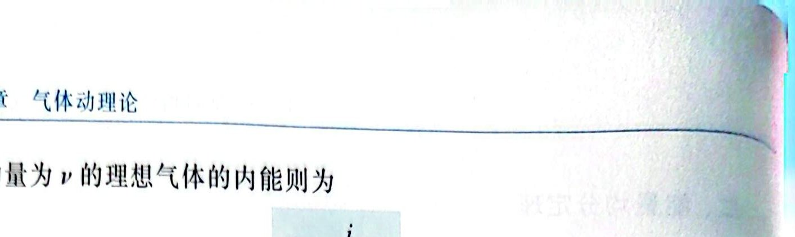
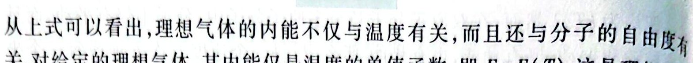
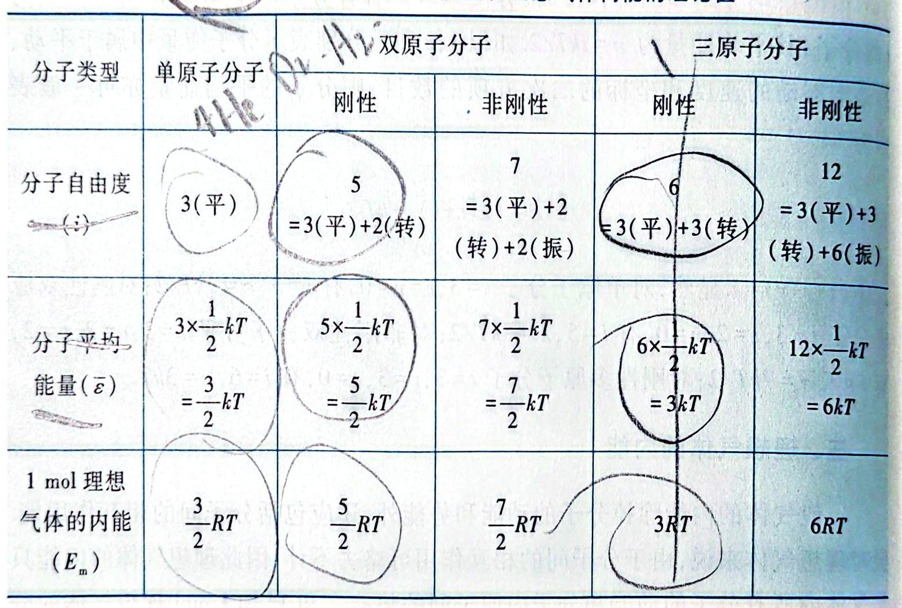

### 本页手写批注

- 本页印刷正文已按扫描转录。手写主要是下划线、对公式的勾画或页边短注；不能确认的笔迹不写入具体符号。

## 扫描第 33 页

> 扫描页码：33 / 45。书中印刷页码见页眉（本页 OCR 未单独认出阿拉伯页码）；页眉含章名；页眉摘录：第十三章热力学基础 上一章从气体分子热运动观点出发，运用统计方法研究了气体分子热运 动的规律及理。

第十三章 热力学基础

上一章从气体分子热运动观点出发,运用统计方法研究了热运动的规律及理想气体的一些热学性质.本章则是从能量观点出发,以大量实验观测为基础,研究物质热现象的宏观基本规律及其应用.

本章的主要内容有:准静态过程、功、热量、内能等基本概念,热力学第一定律及对理想气体各等值过程的应用,理想气体的摩尔热容,循环过程及其效率,卡诺循环,热力学第二定律,熵和熵增加定律以及热力学第二定律的统计意义等.

## 13-1 准静态过程 功 热量

### 一、准静态过程

在热力学中,一般把所研究的宏观物体(如气体、液体、固体、化学电池、电介质、磁介质等)叫做热力学系统,简称系统,也称工作物质,而把与热力学系统相互作用的环境称为外界.限于本课程的要求,我们将主要以理想气体作为热力学系统.

当一热力学系统的状态随时间改变时,系统就经历了一个热力学过程(以下简称过程).由于中间状态不同,热力学过程又分非静态过程和准静态过程.

设一个系统开始时处于平衡态,经过一系列状态变化后到达另一平衡态.一般来说,在实际的热力学过程中,在始末两平衡态之间所经历的中间状态,不可能都是平衡态,而常为非平衡态.所以我们将中间状态为非平衡态的过程称为非静态过程.但是,如果系统在始末两平衡态之间所经历的过程是无限缓慢的,以致系统所经历的每一中间态都可近似地看成平衡态,那么系统的这个状态变化的过程称为准静态过程.下面的例子可当作准静态过程

### 本页手写批注

- 本页印刷正文已按扫描转录。手写主要是下划线、对公式的勾画或页边短注；不能确认的笔迹不写入具体符号。

## 扫描第 34 页

> 扫描页码：34 / 45。书中印刷页码约 230；页眉含章名；页眉摘录：230 第十三章热力学基础 生变化的.然而，也会有这样的情形：当系统与外界之间发生能量传递时，系。

生变化的.然而,也会有这样的情形:当系统与外界之间发生能量传递时,系统的温度可维持不变.例如,当一杯冷水放在高温电炉上加热至沸腾后,水虽被继续加热,但水温却维持在沸点而不再升高.在这种情形下,我们也说外界向系统传递了热量.总之,只要有能量的传递,无论系统的温度是否发生变化,都是热量的传递过程.

## 13-2 热力学第一定律 内能

由前面的讨论已知,系统的状态即能量发生改变,可以由外界向系统传递热量 Q 来实现,也可以由外界对系统做功 $W^{ex}$ 来实现;当然,外界向系统传递热量的同时,又对系统做功,系统能量的改变就与这两者有关了.在热力学中,人们把系统处于某状态而具有的能量,称为系统的内能.设想系统在始状态时的内能为 $E_{0}$ ,当外界向它传递热量和对它做功后,系统达到末状态时的内能为 E.由能量守恒定律,有

$$
E - E _ {0} = Q + W ^ {\mathrm{ex}}
$$

上式表明,系统内能的增量等于外界向系统传递的热量与外界对系统做功之和. 如以 $W$ 表示系统对外界做的功, 那么有 $W^{\mathrm{ex}} = - W$. 于是上式可写成

$$
Q = W + E - E _ {0} = W + \Delta E\tag{13-2}
$$

上式的物理意义是:系统从外界吸收的热量,一部分用于系统对外做功,另一部分用来增加系统的内能.这就是热力学第一定律.显然,热力学第一定律就是包括热现象在内的能量守恒定律.

为便于应用式(13-2)需作如下规定: Q>0 表示系统从外界吸收热量, Q<0 表示系统向外界放出热量; W>0 表示系统对外界做正功, W<0 则表示系统对外界做负功, 即外界对系统做功; $\Delta E>0$ 表示系统内能增加, $\Delta E<0$ 表示系统内能减少.

对于系统状态微小变化的过程,热力学第一定律的数学表达式可写成

$$
\mathrm{d} Q = \mathrm{d} W + \mathrm{d} E\tag{13-3}
$$

上一章在讲述理想气体的内能时曾经说过理想气体的内能是温度的函数, 即 $E = E(T)$. 对一般气体来说, 其内能则是温度和体积的函数, 即 $E = E(V, T)$. 总之, 当气体的状态一定时, 其内能也是一定的, 故气体的内能是气体状态的单值函数. 气体内能的增量 $\Delta E$ 只取决于气体的始末状态, 而与过程无关.

下面我们再强调一下内能 E 的态函数特性. 在图 13-4(a) 中, 一系统从内能

### 本页手写批注

- 本页印刷正文已按扫描转录。手写主要是下划线、对公式的勾画或页边短注；不能确认的笔迹不写入具体符号。

## 扫描第 35 页

> 扫描页码：35 / 45。书中印刷页码约 231；可见节号 13-3；页眉摘录：13-3理想气体的等容过程和等压过程 星摩尔热容 231 为E,的状态 A 可经 ACB 的过程。

> [插图：(a)；(b)；图13-4 系统内能的改变与过程无关]

最后简述一下所谓第一类永动机问题.由热力学第一定律可以知道,要使系统对外做功,必然要消耗系统的内能或由外界吸收热量,或两者皆有.历史上曾有不少人试图制造一种机器,既不消耗系统的内能,又不需要外界向它传递热量,即不消耗任何能量而能不断地对外做功.这种机器叫做第一类永动机.很明显,由于它违反了热力学第一定律而终未制成.所以热力学第一定律也可表述为,第一类永动机是不可能实现的.

13-3 理想气体的等容过程和等压过程 摩尔热容

作为热力学第一定律的应用之一,我们讨论理想气体的等容过程和等压过程中的功、热量、内能和摩尔热容.

### 一、等容过程 摩尔定容热容

在等容过程中,理想气体的体积保持不变.如图13-5所示,等容过程在p-V 图上是一条平行于p轴的直线,即等容线

### 本页手写批注

- 本页印刷正文已按扫描转录。手写主要是下划线、对公式的勾画或页边短注；不能确认的笔迹不写入具体符号。

## 扫描第 36 页

> 扫描页码：36 / 45。书中印刷页码约 232；页眉含章名；可见节号 13-4；页眉摘录：232 第十三章热力学基础 在等容过程中,气体的体积V是常量，气体不对外做功，即dW=pdV=0。

在等容过程中,气体的体积 V 是常量,气体不对外做功,即 $dW_{V}=p\,dV=0$ . 由热力学第一定律,有

$$
\mathrm{d} Q _ {V} = \mathrm{d} E\tag{13-4a}
$$

对有限的等容过程,则有

$$
Q _ {V} = E _ {2} - E _ {1}\tag{13-4b}
$$

上式表明,在等容过程中,气体吸收的热量全部用来增加气体的内能.

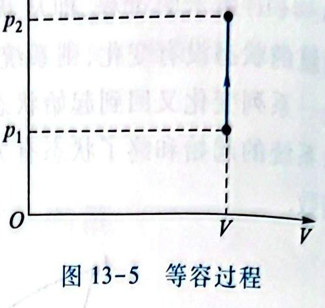

图13-5 等容过程

现在我们来讨论理想气体的摩尔定容热容. 设 $1 \mathrm{~mol}$ 理想气体在等容过程中所吸收的热量为 $\mathrm{d} Q_{V,\mathrm{m}}$，气体的温度由 $T$ 升高到 $T + \mathrm{d} T$，则气体的摩尔定容热容为

$$
C _ {V, \mathrm{m}} = \frac {\mathrm{d} Q _ {V , \mathrm{m}}}{\mathrm{d} T}\tag{13-5}
$$

摩尔定容热容的单位名称为焦耳每摩尔开尔文,符号为 $J \cdot mol^{-1} \cdot K^{-1}$ . 式 (13-5) 可写成

$$
\mathrm{d} Q _ {V, \mathrm{m}} = C _ {V, \mathrm{m}} \mathrm{d} T\tag{13-6a}
$$

对于摩尔定容热容为 $C_{V,\mathrm{m}}$ 而物质的量为 $\nu$ 的理想气体，在等容过程中，其温度由$T_{1}$ 改变为 $T_{2}$ 时，所吸收的热量则为

$$
Q _ {V} = \nu C _ {V, \mathrm{m}} (T _ {2} - T _ {1})\tag{13-6b}
$$

根据式(13-4a)，式(13-6a)亦可写成

$$
\mathrm{d} E _ {\mathrm{m}} = C _ {V, \mathrm{m}} \mathrm{d} T\tag{13-7a}
$$

由上式可以看出,对给定摩尔定容热容 $C_{V,\mathrm{m}}$ 的 $1\mathrm{mol}$ 理想气体,其内能增量仅与温度的增量有关.因此, $1\mathrm{mol}$ 给定的理想气体,无论它经历什么样的状态变化过程,只要温度的增量 $\mathrm{d}T$ 相同,其内能的增量 $\mathrm{d}E$ 就是一定的.这也就是说,理想气体内能的改变只与起始和终了状态温度的改变有关,与状态变化的过程无关.基于这个道理,我们常用式(13-7a)来计算理想气体内能的变化.值得提醒的是:如果起始和终了状态的温度相同,那么在这两状态之间理想气体的内能是不会改变的.

由式(13-7a)可知,物质的量为 $1 \mathrm{~mol}$ 的理想气体的内能增量为 $C_{V,\mathrm{m}} \mathrm{d} T$, 因此对于物质的量为 $\nu$ 的理想气体, 在微小的等容过程中内能的增量为

$$
\mathrm{d} E = \nu C _ {V, \mathrm{m}} \mathrm{d} T\tag{13-7b}
$$

摩尔定容热容 $C_{V

### 本页手写批注

- 本页印刷正文已按扫描转录。手写主要是下划线、对公式的勾画或页边短注；不能确认的笔迹不写入具体符号。

## 扫描第 37 页

> 扫描页码：37 / 45。书中印刷页码约 234；页眉含章名；可见节号 13-8；页眉摘录：234 第十三章热力学基础 APd+ap="0p (13-8) 式(13-8)表明,在等压过程中。

$$
\mathrm{d} Q _ {p} = \mathrm{d} E + p \mathrm{d} V\tag{13-8}
$$

式(13-8)表明,在等压过程中,理想气体吸收的热量一部分用来增加气体的内对有限的等压过程来说,向气体传递的热量为 $Q_{p}$ , 则有得

$$
\begin{array}{c} Q _ {p} = E _ {2} - E _ {1} + \int_ {V _ {1}} ^ {V _ {2}} p \mathrm{d} V \\ Q _ {p} = E _ {2} - E _ {1} + p (V _ {2} - V _ {1}) \end{array}
$$

现在我们讨论理想气体的摩尔定压热容.设1 mol 的理想气体在等压过程中吸收热量 $dQ_{p,m}$ ，温度升高 dT，则气体的摩尔定压热容为

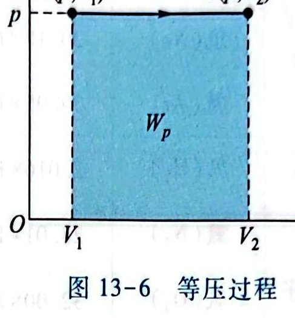

图13-6 等压过程

$$
C _ {p, \mathrm{m}} = \frac {\mathrm{d} Q _ {p , \mathrm{m}}}{\mathrm{d} T}\tag{13-9a}
$$

由上式可得在等压过程中, $1 \mathrm{~mol}$ 理想气体的温度有微小增量时所吸收的热量为

$$
\mathrm{d} Q _ {p, \mathrm{m}} = C _ {p, \mathrm{m}} \mathrm{d} T\tag{13-9b}
$$

对于摩尔定压热容为 $C_{p,m}$ 而物质的量为 $\nu$ 的理想气体, 在等压过程中吸收的热量则为

$$
Q _ {p} = \nu C _ {p, \mathrm{m}} (T _ {2} - T _ {1})\tag{13-9c}
$$

摩尔定压热容的单位与摩尔定容热容的单位相同.利用式(13-8),式(13-9a)可写为

$$
C _ {p, \mathrm{m}} = \frac {\mathrm{d} E _ {\mathrm{m}} + p \mathrm{d} V _ {\mathrm{m}}}{\mathrm{d} T} = \frac {\mathrm{d} E _ {\mathrm{m}}}{\mathrm{d} T} + p \frac {\mathrm{d} V _ {\mathrm{m}}}{\mathrm{d} T}
$$

由于 $dE_{m}/dT=C_{V,m}$ ，又由于对 1 mol 理想气体物态方程 $pV_{m}=RT$ 两边取微分，并考虑到等压过程中 p=常量，可得 $pdV_{m}=RdT$ ，因此上式为

$$
C _ {p, \mathrm{m}} = C _ {V, \mathrm{m}} + R
$$

于是得 $C_{p,\mathrm{m}}$ 与 $C_{V,\mathrm{m}}$ 之差为

$$
C _ {p, \mathrm{m}} - C _ {V, \mathrm{m}} = R\tag{13-10}
$$

上式说明,理想气体的摩尔定压热容与摩尔定容热容之差为摩尔气体常量 $R(\approx 8.31\mathrm{J}\cdot \mathrm{mol}^{-1}\cdot \mathrm{K}^{-1})$ .也就是说,在等压过程中, $1\mathrm{mol}$ 理想气体的温度升高 $1\mathrm{K}$ 时,要比其等容过程多吸收 $8.31\mathrm{J}$ 的热量,以用于对外做功.从表13-1我们可以看到,在通常温度及压强下的气体(即理想气体),无论是单原子气体、双原子气体,还是多原子气体,尽管它们的摩尔定压热容 $C

本页另有从扫描件裁出的图：
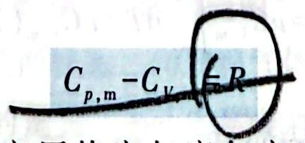

### 本页手写批注

- 本页印刷正文已按扫描转录。手写主要是下划线、对公式的勾画或页边短注；不能确认的笔迹不写入具体符号。

## 扫描第 38 页

> 扫描页码：38 / 45。书中印刷页码约 235；可见节号 13-3；页眉摘录：13-3理想气体的等容过程和等压过程摩尔热容 235 前实验值并不相同，但C,与C，之差即C,-。

体常量 $\pmb{R}$ 的值还是比较接近的.这从另一个侧面反映了热力学第一定律确是包含热现象在内的能量守恒定律.

在实际应用中, 常常用到 $C_{p,\mathrm{m}}$ 与 $C_{V,\mathrm{m}}$ 的比值, 这个比值通常用 $\gamma$ 表示, 有

$$
\gamma = \frac {C _ {p , \mathrm{m}}}{C _ {V , \mathrm{m}}}
$$

表 13-1 给出了几种气体的 $C_{p,\mathrm{m}}$ 的实验值, $C_{p,\mathrm{m}} - C_{V,\mathrm{m}}$ 和 $\gamma$ 的值.

在第十二章的第 12-5 节中, 我们曾从能量按自由度均分定理出发, 得出了物质的量为 $\nu$、自由度为 $i$ 的理想气体的温度改变 $\mathrm{d}T$ 时, 其内能相应的改变为

$$
\mathrm{d} E = \nu \frac {i}{2} R \mathrm{d} T\tag{13-11}
$$

将上式与式(13-7b)相比较可得,摩尔定容热容 $C_{V,\mathrm{m}}$ 和摩尔定压热容 $C_{p,\mathrm{m}}$ 的理论值分别为

$$
C _ {V, \mathrm{m}} = \frac {i}{2} R, \quad C _ {p, \mathrm{m}} = C _ {V, \mathrm{m}} + R = \frac {i + 2}{2} R\tag{13-12}
$$

依照上式可得几种理想气体的 $C_{V,m}$ 和 $C_{p,m}$ 的理论值 $^{①}$ ，如表 13-2 所示.

表 13-2 理想气体分子自由度和摩尔热容的理论值

$(C_{p,m}, C_{V,m}$ 的单位均为 $J \cdot mol^{-1} \cdot K^{-1}, R$ 取 $8.31\ J \cdot mol^{-1} \cdot K^{-1})$

| 气体 | i | $C_{V,m}$ | $C_{p,m}$ | $C_{p,m}-C_{V,m}$ | $\gamma=C_{p,m}/C_{V,m}$ |
| --- | --- | --- | --- | --- | --- |
| 单原子分子 | 3 | $\frac{3}{2}R=12.47$ | $\frac{5}{2}R=20.78$ | 8.31 | 1.67 |
| 刚性双原子分子 | 5 | $\frac{5}{2}R=20.78$ | $\frac{7}{2}R=29.09$ | 8.31 | 1.40 |
| 非刚性双原子分子 | 7 | $\frac{7}{2}R=29.09$ | $\frac{9}{2}R=37.39$ | 8.31 | 1.29 |
| 刚性三原子分子 | 6 | 3R=24.93 | 4R=33.24 | 8.31 | 1.33 |
| 非刚性三原子分子 | 12 | 6R=49.86 | 7R=58.17 | 8.31 | 1.17 |

将表 13-2 中的理想气体摩尔热容的理论值与表 13-1 中相关的实验值相比较可以看出,在 ${1.013} \times {10}^{5}\mathrm{{Pa}}$ 、 ${25}{}^{ \circ }\mathrm{C}$ 的实验条件下,各种气体特别是单原子分子气体和双原子分子气体,其 ${C

> 注：① 气体的 $C_{V,\mathrm{m}}$ 和 $C_{p,\mathrm{m}}$ 由实验测定，但作一般计算时，可用表13-2中的理论值.

本页另有从扫描件裁出的图：
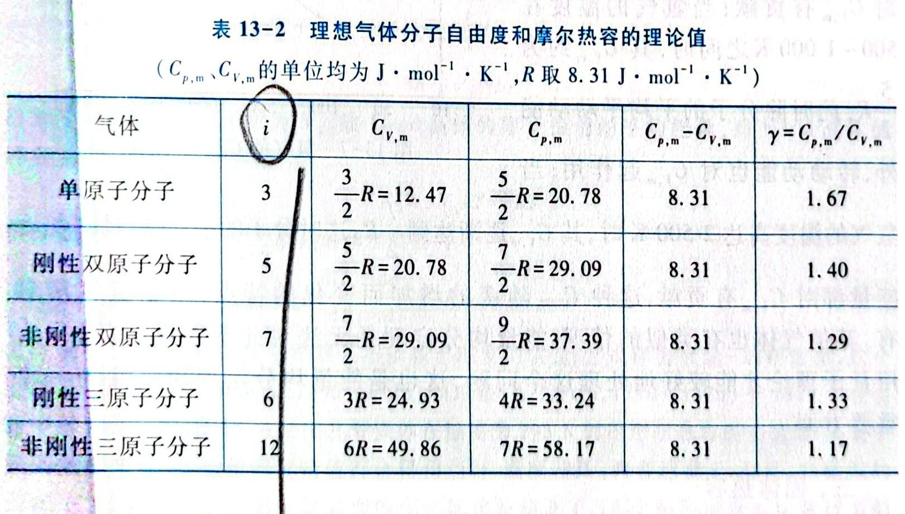

### 本页手写批注

- 本页印刷正文已按扫描转录。手写主要是下划线、对公式的勾画或页边短注；不能确认的笔迹不写入具体符号。

## 扫描第 39 页

> 扫描页码：39 / 45。书中印刷页码约 240；页眉含章名；可见节号 13-1；页眉摘录：240 第十三章热力学基础 Q= W,=vRTln =vRTln P1 (13-14) P2 上。

$$
Q _ {T} = W _ {T} = \nu R T \ln \frac {V _ {2}}{V _ {1}} = \nu R T \ln \frac {p _ {1}}{p _ {2}}\tag{13-14}
$$

上式表明,在理想气体的等温过程中,当气体膨胀(即 $V_{2} > V_{1}$)时,$W_{T}$和$Q_{T}$均取正值,气体从恒温热源吸收的热量全部用于对外做功;当气体被压缩(即 $V_{2} < V_{1}$)时,$W_{T}$和$Q_{T}$均取负值,此时外界对气体所做的功,全部以热量形式由气体传递给恒温热源.

### 二、绝热过程

绝热过程是热力学过程中一个十分重要的过程。在气体的状态发生变化的过程中,如果它与外界之间没有热量传递,这种过程叫做绝热过程。实际上,绝对的绝热过程是没有的,但在有些过程的进行中,虽然系统与外界之间有热量传递,但所传递的热量很小,以致可忽略不计,这种过程就可近似作为绝热过程。可作为绝热过程的实例是很多的。在工程上,蒸汽机气缸中蒸汽的膨胀,柴油机中受热气体的膨胀,压缩机中空气的压缩等,常常可近似地看作绝热过程。这些过程进行得很迅速,在过程进行时只有很少的热量通过器壁进入或离开系统。此外,声波在空气中传播时,空气的压缩和膨胀过程也可看作绝热过程。但这些实际的绝热过程不是我们所要讨论的,下面介绍的绝热过程却是进行得非常缓慢的准静态过程。

如图 13-10(a) 所示, 在一密闭气缸中贮有理想气体, 气缸壁、气缸底部和活塞均由绝热材料制成. 活塞与气缸壁间的摩擦略去不计. 绝热过程的特征是 $\mathrm{d}Q = 0$. 理想气体的绝热过程在 $p - V$ 图上的过程曲线, 称为绝热线, 如图 13-10(b) 所示.

> [插图：(a) 气体被绝热材料所包围；(b) 绝热过程中气体做的功；图13-10 理想气体的绝热过程

本页另有从扫描件裁出的图：

图13-10理想气体的绝热过程

### 本页手写批注

- 本页印刷正文已按扫描转录。手写主要是下划线、对公式的勾画或页边短注；不能确认的笔迹不写入具体符号。

## 扫描第 40 页

> 扫描页码：40 / 45。书中印刷页码约 241；可见节号 13-4；页眉摘录：13-4理想气体的等温过程和绝热过程多方过程 241 因为在绝热过程中dQ=0,所以由热力学第一。

13-4 理想气体的等温过程和绝热过程 多方过程

作为应用热力学第一定律的典型过程,我们讨论理想气体的等温过程和绝热过程.

### 一、等温过程

> 注：① 恒温热源也称为热库,它所具有的能量较之从它吸收或者向它传入的能量相比要大得多,故其温度可视为不变.恒温热源也是理想化的热源.

> [插图：(a) 贮有气体的气缸与恒温热源 $T$ 相接触；(b) 等温过程中气体做的功；图13-9 理想气体的等温过程]

因为在等温过程中,内能不变化,所以由热力学第一定律有

$$
\mathrm{d} Q _ {T} = \mathrm{d} W _ {T} = p \mathrm{d} V
$$

$$
W _ {T} = \int_ {V _ {1}} ^ {V _ {2}} p \mathrm{d} V
$$

$$
W _ {T} = \nu R T \int_ {V _ {1}} ^ {V _ {2}} \frac {\mathrm{d} V}{V} = \nu R T \ln \frac {V _ {2}}{V _ {1}}
$$

因为 $p_1V_1 = p_2V_2$ ，上式也可写成

$$
W _ {T} = \nu R T \ln \frac {p _ {1}}{p _ {2}}
$$

$$
Q _ {T} = W _ {T} = \nu R T \ln \frac {V _ {2}}{V _ {1}} = \nu R T \ln \frac {p _ {1}}{p _ {2}}\tag{13-14}
$$

### 二、绝热过程

> [插图：(a) 气体被绝热材料所包围；(b) 绝热过程中气体做的功；图13-10 理想气体的绝热过程]

因为在绝热过程中 $\mathrm{d}Q = 0$ ，所以由热力学第一定律有

$$
0 = \mathrm{d} E + \mathrm{d} W _ {\mathrm{a}}
$$

$$
0 = \nu C _ {V, \mathrm{m}} \mathrm{d} T + p \mathrm{d} V\tag{13-15}
$$

对理想气体物态方程 $pV = \nu RT$ 取微分，有

$$
p \mathrm{d} V + V \mathrm{d} p = \nu R \mathrm{d} T\tag{13-16}
$$

由式(13-15)和式(13-16)可得

$$
C _ {V, \mathrm{m}} p \mathrm{d} V + C _ {V, \mathrm{m}} V \mathrm{d} p = - R p \mathrm{d} V
$$

将 $R = C_{p,\mathrm{m}} - C_{V,\mathrm{m}}$ 及 $\gamma = C_{p,\mathrm{m}} / C_{V,\mathrm{m}}$ 代入上式，得

$$
\gamma \frac {\mathrm{d} V}{V} = - \frac {\mathrm{d} p}{p}
$$

积分,有得

$$
\begin{array}{c} {{\gamma \ln V + \ln p = \mathrm{常量}}} \\ {{p V ^ {\gamma} = \mathrm{常量}}} \end{array}\tag{13-17a}
$$

这就是理想气体绝热过程的 $p - V$ 函数关系.

将理想气体物态方程 $pV=\nu RT$ 代入上式, 分别消去 p 或 V, 可得

$$
V ^ {\gamma - 1} T = \text {常量}\tag{13-17b}
$$

$$
p ^ {\gamma - 1} T ^ {- \gamma} = \text {常量}\tag{13-17c}
$$

式(13-17a)、式(13-17b)和式(13-17c)统称为理想气体的绝热过程方程,简称绝热方程.但式中各个常量是不相同的.

由式(13-15)可求得,在有限过程中理想气体做的功为

$$
W _ {\mathrm{a}} = \int p \mathrm{d} V = - \nu C _ {V, \mathrm{m}} \int_ {T _ {1}} ^ {T _ {2}} \mathrm{d} T = - \nu C _ {V, \mathrm{m}} (T _ {2} - T _ {1})\tag{13-18a}
$$

从上式可以看出,如 $T_{1} > T_{2}$ 则 $W_{\mathrm{a}} > 0$, 气体绝热膨胀; 如 $T_{1} < T_{2}$, 则 $W_{\mathrm{a}} < 0$, 气体被绝热压缩. 气体在被绝热压缩时温度升高, 绝热膨胀时温度降低这两个结论, 常在许多实际问题中用到. 例如, 用打气筒向轮胎打气时, 筒壁会发热; 压缩空气从喷嘴中急速喷出时, 气体绝热膨胀, 气体变冷, 甚至被液化.

理想气体绝热做功的表达式也可以用物态参量 p、V 表示为

$$
W _ {\mathrm{a}} = \frac {p _ {1} V _ {1} - p _ {2} V _ {2}}{\gamma - 1}\tag{13-18b}
$$

读者自己可以推证

本页另有从扫描件裁出的图：

### 本页手写批注

- 本页印刷正文已按扫描转录。手写主要是下划线、对公式的勾画或页边短注；不能确认的笔迹不写入具体符号。

## 扫描第 41 页

> 扫描页码：41 / 45。书中印刷页码约 246；页眉含章名；可见节号 13-1；页眉摘录：246 第十三章热力学基础 是多种多样的，所以不能都视为等值过程和绝热过程， 与理想气体的绝热过。

是多种多样的,所以不能都视为等值过程和绝热过程.

与理想气体的绝热过程方程相似,理想气体的多方过程方程除具有式(13-19a)的形式外,还可写成

$$
\begin{array}{c} T V ^ {n - 1} = C \\ p ^ {n - 1} T ^ {- n} = C \end{array}\tag{13-19b}
$$

与式(13-18b)相似,理想气体在多方过程中做的功为

$$
W _ {\mathrm{a}} = \frac {p _ {1} V _ {1} - p _ {2} V _ {2}}{n - 1}
$$

而在多方过程中内能的增量仍为

图13-14 用多方指数表示的多方过程

$$
\Delta E = \nu C _ {V, \mathrm{m}} (T _ {2} - T _ {1})
$$

这是理想气体内能的改变仅与其始末状态有关而与过程无关的缘故.而在多方过程中吸收的热量则为

$$
Q = \nu C _ {n, \mathrm{m}} (T _ {2} - T _ {1})
$$

式中 $C_{n,\mathrm{m}}$ 为理想气体多方摩尔热容.至于理想气体的 $C_{n,\mathrm{m}}$ 与 $C_{V,\mathrm{m}}$ 的关系①，可算得为

$$
C _ {n, \mathrm{m}} = \left(\frac {n - \gamma}{n - 1}\right) C _ {V, \mathrm{m}}
$$

## 13-5 循环过程 卡诺循环

### 一、循环过程

在生产技术上要将热与功之间的转化持续地进行下去,这就需要利用循环过程.系统经过一系列状态变化以后,又回到原来状态的过程叫做热力学循环过程,简称循环.

现考虑以气体为工作物质的循环过程.如图13-15所示,设气体吸收热量膨胀而推动气缸的活塞,经准静态过程从状态A到状态B,在此膨胀过程中,气体所做的功为 $W_{AB}$ .若使气体从状态B沿原来的路径压缩到状态A,则气体所做的功为 $W_{BA}=-W_{AB}$ .上述从状态A出发又回到状态A的过程,也为一循环过程.但是在这个循环过程中,系统所做的净功为零,即 $W_{AB}+W_{BA}=0$ .

若气体在压缩过程中所经过的路径,与在膨胀过程中所经过的路径不重复,如图13-16(a)所示.气体由起始状态 $A(p_{A},V_{A},T_{A})$ 沿过程 $AaB$ 膨胀到状态$B(p_{B},V_{B},T_{B})$ ,在此过程中,气体对外所做的功等于 $A,B$ 两点间过程曲线 $AaB$下面的面积.然后再将气体由状态 B 沿过程 BbA 压缩到起始状态 A.在压缩过程中,外界对气体所做的功等于 A、B 两点间过程曲线 BbA 下面的面积.所以气体经历一个循环以后,对外所做的净功 W 应是由 AaB 和 BbA 两个过程组成的循环所包围的面积[图 13-16(b)].应当指出,在任何一个循环过程中,系统所做的净功都等于 p-V 图上所示循环包围的面积.

> 注：① 关于 $C_{n,\mathrm{m}}$ 与 $C_{V,\mathrm{m}}$ 的关系, 可参阅秦允豪主编《普通物理学教程 热学》(第四版)第207页(高等教育出版社, 2018年

### 本页手写批注

- 本页印刷正文已按扫描转录。手写主要是下划线、对公式的勾画或页边短注；不能确认的笔迹不写入具体符号。

## 扫描第 42 页

> 扫描页码：42 / 45。书中印刷页码约 248；页眉含章名；可见节号 13-1；页眉摘录：248 第十三章热力学基础 冷机（也叫热泵）①，它是利用外界做功使热量由低温处流人高温处，从而获。

冷机(也叫热泵) $^{①}$ ，它是利用外界做功使热量由低温处流入高温处，从而获得低温的机器。

如图 13-17(a) 所示,一热机经过一个正循环后,由于它的内能不变化,因此,它从高温热源吸收的热量 ${Q}_{1}$ ,一部分用于对外做功 $W$ ,另一部分则向低温热源放热, ${Q}_{2}$ 为向低温热源放出的热量. 这就是说,在热机经历一个正循环后,吸收的热量 ${Q}_{1}$ 不能全部转化为功,转化为功的只是 ${Q}_{1} - \left| {Q}_{2}\right| = W$ . 通常把

$$
\eta = \frac {W}{Q _ {1}} = \frac {Q _ {1} - | Q _ {2} |}{Q _ {1}} = 1 - \frac {| Q _ {2} |}{Q _ {1}}\tag{13-20}
$$

叫做热机效率或循环效率.第一部实用的热机是蒸汽机②[图 13-17(b)]，它创制于 17 世纪末,用于煤矿中抽水.目前蒸汽机主要用于发电厂中.热机除蒸汽机外,还有内燃机、喷气机等①.虽然它们在工作方式、效率上各不相同,但工作原理却基本相同,都是不断地把热量转化为功.下面给出了几种装置的热效率(热转化为功的比率):

(a) 热机的示意图；(b) 蒸汽机的示意图；图13-17

> 注：① 关于热泵较具体的介绍和利用制冷机在制冰过程中所耗费功的计算,可分别参阅马文蔚等主编《物理学原理在工程技术中的应用》(第四版)之“热泵”和“能制多少冰?”.

> 注：② 有些出版物误传蒸汽机是瓦特发明的,其实不是.蒸汽机的模型很早就有人提出,英国人萨维利(Savery)于1698年、纽可门(Newcomen)于1705年各自独立发明了蒸汽机,用于矿井抽水,当时效率很低.1765年,瓦特(J.Watt,1736—1819,英国人)在纽可门机的基础上,对蒸汽机作了重大改进,使冷凝器与气缸分离,发明曲轴和齿轮传动以及离心调速器等,使蒸汽机实现了现代化,大大地提高了蒸汽机效率.瓦特的这些发明,仍使用在现代蒸汽机中.为纪念瓦特的贡献,功率的单位名称以其姓氏命名

本页另有从扫描件裁出的图：

### 本页手写批注

- 本页印刷正文已按扫描转录。手写主要是下划线、对公式的勾画或页边短注；不能确认的笔迹不写入具体符号。

## 扫描第 43 页

> 扫描页码：43 / 45。书中印刷页码约 249；可见节号 13-5；页眉摘录：13-5循环过程卡诺循环 249 有内燃机、喷气机等①.虽然它们在工作方式、效率上各不相同，但工。

有内燃机、喷气机等①.虽然它们在工作方式、效率上各不相同,但工作原理却基本相同,都是不断地把热量转化为功.下面给出了几种装置的热效率(热转化为功的比率):

(a) 热机的示意图；(b) 蒸汽机的示意图；图13-17

> 注：① 关于热泵较具体的介绍和利用制冷机在制冰过程中所耗费功的计算,可分别参阅马文蔚等主编《物理学原理在工程技术中的应用》(第四版)之“热泵”和“能制多少冰?”.

> 注：② 有些出版物误传蒸汽机是瓦特发明的,其实不是.蒸汽机的模型很早就有人提出,英国人萨维利(Savery)于1698年、纽可门(Newcomen)于1705年各自独立发明了蒸汽机,用于矿井抽水,当时效率很低.1765年,瓦特(J.Watt,1736—1819,英国人)在纽可门机的基础上,对蒸汽机作了重大改进,使冷凝器与气缸分离,发明曲轴和齿轮传动以及离心调速器等,使蒸汽机实现了现代化,大大地提高了蒸汽机效率.瓦特的这些发明,仍使用在现代蒸汽机中.为纪念瓦特的贡献,功率的单位名称以其姓氏命名.

$$
\begin{array}{r l r} {\mathrm{液体燃料火箭}} & & {\eta = 0.48} \\ {\mathrm{燃气轮机}} & & {\eta = 0.46} \\ {\mathrm{柴油机}} & & {\eta = 0.37} \\ {\mathrm{汽油机}} & & {\eta = 0.25} \\ {\mathrm{蒸汽机车}} & & {\eta = 0.08} \\ {\mathrm{热电偶}} & & {\eta = 0.07} \end{array}
$$

> [插图：图13-18 制冷机的示意图]

图 13-18 是一个制冷机原理的示意图, 它从低温热源吸取热量而膨胀, 并在压缩过程中, 把热量放出给高温热源. 为实现这一点, 外界必须对制冷机做功. 图中 $Q_{2}$ 为制冷机从低温热源吸收的热量, $W$ 为外界对它做的功, $Q_{1}$ 为它放出给高温热源的热量.于是当制冷机完成一个逆循环后有 $\left|W\right| = \left|Q_{1}\right| - Q_{2}$.这就是说,制冷机经历一个逆循环后,由于外界对它做功,可把热量由低温热源传递到高温热源.外界不断做功,就能不断地从低温热源吸取热量,然后传递到高温热源.这就是制冷机的工作原理.通常把

$$
e = \frac {Q _ {2}}{| W |} = \frac {Q _ {2}}{| Q _ {1} | - Q _ {2}}\tag{13-21}
$$

叫做制冷机的制冷系数.

**例1**

1 mol 理想气体经历下列四个准静态过程. 如图 13-19 所示, $A \to B$ 是绝热压缩过程, $B \to C$ 是等容升压过程, $C \to D$ 是绝热膨胀过程, $D \to A$ 是等容减压过程. 求此循环的效率.

解 设气体状态为 $A, B, C$ 和 $D$ 时的温度分别为 $T_{A}, T_{B}, T_{C}$ 和 $T_{D}$. 由绝热方程有

$$
\frac {T _ {B}}{T _ {A}} = \left(\frac {V _ {1}}{V _ {2}}\right) ^ {\gamma - 1}, \quad \frac {T _ {C}}{T _ {D}} = \left(\frac {V _ {1}}{V _ {2}}\right) ^ {\gamma - 1}
$$

> 注：① 长期以来,人们都在寻求提高热机效率的方法,这方面的内容可参阅马文蔚等主编《物理学原理在工程技术中的应用》(第四版)之“提高热机效率的两种方法

### 本页手写批注

- 本页印刷正文已按扫描转录。手写主要是下划线、对公式的勾画或页边短注；不能确认的笔迹不写入具体符号。

## 扫描第 44 页

> 扫描页码：44 / 45。书中印刷页码约 250；页眉含章名；页眉摘录：250 第十三章热力学基础 则有 T, Tc T, Tc-Tn T,T,' T、T,-T 此外，。

此外,在 $B \rightarrow C$ 等容增压过程中,吸收的热量为

$$
Q _ {1} = C _ {V} (T _ {C} - T _ {B})
$$

而在 $D \to A$ 等容减压过程中, 放出的热量则为

$$
Q _ {2} = - C _ {V} (T _ {D} - T _ {A})
$$

故此循环的效率为

$$
\eta = \frac {Q _ {1} - | Q _ {2} |}{Q _ {1}} = 1 - \frac {T _ {D} - T _ {A}}{T _ {C} - T _ {B}} = 1 - \frac {T _ {A}}{T _ {B}} = 1 - \left(\frac {V _ {2}}{V _ {1}}\right) ^ {\gamma - 1}
$$

图13-19

式中 $V_{2}/V_{1}=r, r$ 叫做压缩比，则上式为

$$
\eta = 1 - r ^ {\gamma - 1}
$$

应当指出,本题所述的循环是被称为四冲程汽油机的奥托(Otto)循环.

### 三、卡诺循环

由于瓦特改进了蒸汽机,使热机的效率大为提高,人们迫切要求进一步提高热机的效率.那么,提高热机效率的主要方向在哪里呢?提高热机效率有没有极限呢?为此,法国的年轻工程师卡诺(S.Carnot,1796—1832)于1824年提出一个工作在两热源之间的理想循环——卡诺循环,找到了在两个给定热源温度的条件下,热机效率的理论极限值;他还提出了著名的卡诺定理.这里先介绍卡诺循环,下一节再讲述卡诺定理.

卡诺循环是由四个准静态过程所组成的,其中两个是等温过程,两个是绝热过程.卡诺循环对工作物质是没有规定的,为方便讨论,我们以理想气体为工作物质.如图13-20(a)所示,曲线AB和CD分别是温度为 $T_{1}$ 和 $T_{2}$ 的两等温线,曲线BC和DA分别是两条绝热线.如气体从点A出发,按顺时针方向沿封闭曲线ABCDA进行,这种正循环为卡诺正循环,即卡诺热机.

由热力学第一定律可求得在四个过程中,气体的内能、对外做功和传递热量间关系如下:

(1) 在 $AB$ 的等温膨胀过程中, 气体的内能没有改变, 而气体对外做的功 $W_{1}$, 等于气体从温度为 $T_{1}$ 的高温热源中吸收的热量 $Q_{1}$, 即

$$
W _ {1} = Q _ {1} = \nu R T _ {1} \ln \frac {V _ {2}}{V _ {1}}\tag{13-22}
$$

本页另有从扫描件裁出的图：

### 本页手写批注

- 本页印刷正文已按扫描转录。手写主要是下划线、对公式的勾画或页边短注；不能确认的笔迹不写入具体符号。

## 扫描第 45 页

> 扫描页码：45 / 45。书中印刷页码约 252；页眉含章名；可见节号 13-2；页眉摘录：252 第十三章热力学基础 把它代人循环效率式（13-20)得,以理想气体为工作物质的卡诺热机效。

把它代入循环效率式(13-20)得,以理想气体为工作物质的卡诺热机效率为

$$
\eta = 1 - \frac {T _ {2}}{T _ {1}} = \frac {T _ {1} - T _ {2}}{T _ {1}}\tag{13-24}
$$

从上式可以看出:要完成一次卡诺循环必须有高温和低温两个热源;高温热源的温度越高,低温热源的温度越低,则卡诺循环的效率越高.

下面讨论图 13-21(a) 所示的由两个绝热过程和两个等温过程组成的卡诺逆循环, 即卡诺制冷机. 图中 $BA$ 和 $DC$ 是等温线, $AD$ 和 $CB$ 是绝热线. 设工作物质仍为理想气体, 它从温度为 $T_{1}$ 的点 $A$ 绝热膨胀到点 $D$, 在此过程中, 气体的温度逐渐降低, 在点 $D$ 时气体的温度为 $T_{2}$. 接着, 气体等温膨胀到点 $C$, 它从低温热源中吸收热量 $Q_{2}$. 然后, 气体被绝热压缩到点 $B$, 由于外界对气体做功, 使它的温度上升到 $T_{1}$. 最后, 气体被等温压缩到点 $A$, 使气体回到起始的状态, 在此过程中它把热量 $Q_{1}$ 传递给高温热源.

(a) $p - V$ 图；(b) 工作示意图；图13-21 卡诺逆循环——制冷机

由于 $\left|Q_{1}\right|/T_{1}=Q_{2}/T_{2}$ ，由制冷系数的表达式(13-21)可得，卡诺制冷机的制冷系数e为

$$
e = \frac {Q _ {2}}{| Q _ {1} | - Q _ {2}} = \frac {T _ {2}}{T _ {1} - T _ {2}}\tag{13-25}
$$

**例2**

一台电冰箱放在室温为 $20^{\circ}\mathrm{C}$ 的房间里, 冰箱贮物柜内的温度维持在 $5^{\circ}\mathrm{C}$. 现每天有 $2.0\times 10^{8}\,\mathrm{J}$ 的热量传入冰箱. 若要使冰箱内温度不变, 外界每天需做多少功? 其功率为多少? 设在 $5^{\circ}\mathrm{C}$ 和 $20^{\circ}\mathrm{C}$ 之间运转的制冷机(电冰箱)的制冷系数, 是卡诺制冷机的制冷系数的 55%.

页末右侧有一短笔迹，【无法辨认】。例题解答未印在本页。

本页另有从扫描件裁出的图：

### 本页手写批注

- 【手写】页左空白处有若干箭头和短词，指向卡诺热机效率式(13-24)，笔迹潦草，【无法辨认】完整词句，不据此改效率公式。
- 例 2 的温度、热量和 55% 按印刷文字转录，没有把手写涂改成另一组数据。

## 核对说明

- 扫描件共 45 页，上文「扫描第 1 页」至「扫描第 45 页」逐页都有正文。
- 页与页之间常常跳过教材中未收入扫描件的页面，因此题号、公式号和句子不会在扫描顺序上连成教材全文。
- 仍标【无法辨认】的手写，不把猜出来的符号写进公式。主要不确定处：扫描第 5 页例题旁的演算、第 7 页图旁一行字、第 14 页页下大段斜写、第 45 页页边箭头，都只保留了能辨认的部分。扫描第 8 页在「缓慢的周」处换页；扫描第 31 页在「可得」处截断，页内没有完整印出后续公式，因此不补式(12-6)。第 16–29 页和第 32–44 页的手写多是下划线，没有逐笔另抄成新公式。
